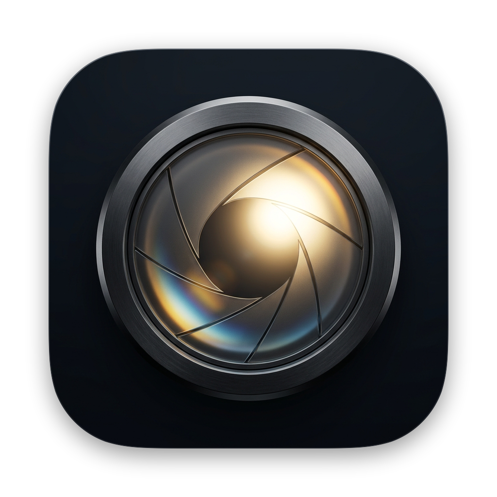

<p align="center">
  
</p>

# Chiaro

**Native macOS HDR-First RAW Darkroom & Batch CLI** — built in Swift 6 & Metal for Apple Silicon.

Chiaro (*Italian for "light, bright, clear" — from Chiaroscuro*) develops camera RAW files (`.ARW`) in a scene-linear `rgba16Float` Metal GPU pipeline and exports standards-compliant **ISO/IEC 21496-1:2025 Gain Map HDR** photos and **10-bit BT.2020 HLG** motion exports across Apple Photos, Chrome/Web, Android, Xiaohongshu (小红书), and Douyin (抖音).

[](#requirements)
[](#building-from-source)
[](LICENSE)
[](THIRD_PARTY_NOTICES.md)

---

## Highlights (V1.1)

- **Dual RAW Decoding & High-Precision Demosaicing**
  - **LibRaw `0.22.3` (`LGPL-2.1`) + `librtprocess 0.12.0` (`GPL-3.0-or-later`, default)**: 14-bit unclipped linear decode with **`AMaZE` / `LMMSE` / `DCB` / `DHT` / `AHD`** demosaicing, Sony Lossless Compressed `.ARW` support, and fast GCD proxy previews (`≤ 300ms`).
  - **Apple `CIRAWFilter` v9 (optional `--backend ciraw9`)**: Native Apple Neural Engine (ANE) demosaicing and high-ISO night denoising.
- **Dual Open-Source Auto Optical Correction (Metal GPU)**
  - **Engine A (Primary)**: Extracts Sony `.ARW` embedded SubIFD factory optical curves (distortion, red/blue TCA, vignetting) using `darktable` (`GPL-3.0-or-later`) evaluation formulas.
  - **Engine B (Complement & Fallback)**: Bundled offline **`Lensfun 0.3.4` (`LGPL-3.0-only`)** XML database (`CC-BY-SA-3.0`) with Sony E-mount full-frame (`1.0×`) / APS-C (`1.5×`) fallback and custom user XML import.
  - Both engines compile into a unified `256×192` GPU LUT executed in a single-pass Catmull-Rom Bicubic `rgba16Float` Metal shader with zero HDR `>1.0` clipping.
- **darktable GPL-3.0 Metal GPU Image Quality Engines**
  - **Profiled Wavelet Denoise**: Bundled Sony `ILCE-7CM2` / `ILCE-7M4` Poisson-Gaussian noise model (`noiseprofiles.json`), executing GAT + 4-level À-trous wavelet denoise + IGAT in Metal strictly before optical warping.
  - **`Sigmoid` Tone Mapper & Upgraded `Inpaint Opposed`**: Generalized log-logistic SDR tone mapping alongside `AgX` / `Neutral Rational` / `OpenDRT`, plus darktable median-chrominance highlight reconstruction.
  - **Halo-Free `Clarity` & Physical `Optical Sharpness`**: Edge-aware local contrast and inverse-diffusion sharpening in Linear Rec.2020 `rgba16Float`.
- **Scene-Linear Metal GPU Pipeline & ISO/IEC 21496-1:2025 Gain Map Engine**
  - `rgba16Float` + bucketed `MTLHeap` texture pool (`<= 4.5 GiB` Peak RSS on full 35-image 33MP batches), OKLab soft gamut compression, 64×64 Blue-Noise TPDF dithering, 1ch (`L008`) & 3ch (`BGRA`) gain maps, and closed-loop JPEG compensation.
- **Four ADR-Compliant Export Pipelines (Single Decode, Parallel Fan-Out)**
  - **HEIC (`.heic`)**: 10-bit/8-bit Display P3 + ISO 21496-1 `tmap` (optional iOS 14–17 1ch legacy dual-write).
  - **JPEG (`.jpg`)**: 1ch Ultra HDR v1.1 via `google/libultrahdr` and 3ch pure ISO APP2 + MPF via `ImageIO`.
  - **AVIF (`.avif`)**: `libavif` + `SVT-AV1` / `libaom` 10-bit Display P3 + ISO `tmap` + automatic **MIAF Baseline 5.1 Grid Tiling**.
  - **10-bit HLG MP4 (`.mp4`)**: Native `AVAssetWriter` + VideoToolbox 10-bit HEVC Main10 `BT.2020 HLG` (`1080×1920` / `1080×1440`, 30fps, 12–16 Mbps).
- **Non-Destructive Sidecars, Dual-Mode UI & Liquid Glass**
  - Atomic `.chiaro.json` (`schemaVersion = 2`) sidecars shared between `Chiaro.app` and `chiaro-cli`.
  - Lossless **Preset Mode ⇄ Pro Mode** (`⌘⇧P`) with 100% bilingual (`zh-Hans` / `en`) parameter documentation (`?` popovers & inline summaries) and native macOS 26+ **Apple Liquid Glass** (macOS 15 `.ultraThinMaterial` fallback) with `#111214` neutral darkroom canvas.
- **GPL-3.0-or-later License & SBOM Compliance**
  - Verified by [`Scripts/verify_licenses.sh`](Scripts/verify_licenses.sh) across sources, static archives, symbols (`nm`), and recursive Mach-O linkage (`otool -L`).

---

## Supported Cameras

Chiaro's core linear pipeline (`ChiaroCore`), Lensfun integration, and `.chiaro.json` sidecar schema are camera-agnostic, while v1.1 focuses exclusively on verified **Sony `.ARW`** workflows to ensure color accuracy and regression quality.

| Tier | Brand | Model | Format | Verification Status |
|---|---|---|---|---|
| **Tier 1 (Golden Baseline)** | **Sony** | **α7C II (`ILCE-7CM2`)** | `.ARW` (FF 33MP `7008×4672` & APS-C 14MP `4608×3072`, Lossless Compressed, ISO 1600–12800) | Officially verified with real sample suite (Embedded SubIFD Optics, Profiled Noise Model, Lensfun E-mount fallback, 4-way HDR exports) |
| **Same-Generation Sony** | Sony | Other Bayer E-mount cameras | `.ARW` | Compatible via camera-agnostic linear pipeline & Lensfun XML DB (not individually regression-tested) |

> **Expansion Policy:** Untested camera brands are intentionally omitted until verified with real CC0 RAW samples and full color/E2E tests.

---

## Roadmap

- [x] **V1.0**: Scene-linear Metal pipeline, dual RAW decoders (`LibRaw` + `CIRAWv9`), ISO 21496-1 HEIC / Ultra HDR JPEG / Grid-Tiled AVIF / 10-bit HLG MP4, 7 built-in presets, `chiaro` CLI, and 120Hz EDR `Chiaro.app`.
- [x] **V1.1**: `GPL-3.0-or-later` license switch, `AMaZE`/`LMMSE`/`DCB`/`DHT`/`AHD` demosaicing, dual open-source auto optical correction (Embedded `.ARW` curves + offline `Lensfun`), `darktable` Metal GPU quality engines (`Profiled Denoise`, `Sigmoid`, `Clarity`, `Optical Sharpness`, `Inpaint Opposed`), `.chiaro.json` sidecars, Preset/Pro dual mode, 100% bilingual parameter docs, and Liquid Glass UI.
- [ ] **V2.0 — Apple ANE AI Denoise**: CoreML + Apple Neural Engine neural RAW denoising (`NAFNet`/`NIND`) conditioned on sensor noise profiles (`docs/v1.1/PRD.md`, `ADR-017`).
- [ ] **V3.0 — Multimodal LLM/VLM Color Grading Studio**: Deterministic `Color Balance RGB` + `Tone Equalizer` driven by cloud/local VLM recipes (`docs/v1.1/PRD.md`, `ADR-018`).

---

## Quick Start

### Option 1: Download Prebuilt Release (Apple Silicon, macOS 15+)

Download from [**GitHub Releases**](https://github.com/ZhangLiangchen/Chiaro/releases):
- **`Chiaro-1.1.0-macos-arm64.zip`**: Standalone `Chiaro.app` with bundled Lensfun DB, noise profiles, and dynamic AV1 frameworks (no Homebrew required).
- **`chiaro-cli-1.1.0-macos-arm64.tar.gz`**: Standalone `chiaro` CLI + resource bundle + bundled AV1 dylibs.

> **Note (ad-hoc signed open-source build):** If macOS Gatekeeper warns on first launch, run:
> ```bash
> xattr -dr com.apple.quarantine /Applications/Chiaro.app
> ```

### Option 2: CLI Usage (`chiaro`)

```bash
# List all 7 built-in presets
chiaro --list-presets

# Export Apple Photos 10-bit Display P3 HEIC (default preset)
chiaro ./RAW_Photos -o ./output

# Export Xiaohongshu HDR JPEG (3:4, <= 2048px, <= 4MB, 1ch Ultra HDR v1.1)
chiaro ./RAW_Photos -p xiaohongshu_jpg -o ./output_xhs

# Export Tri-Format Archive (10-bit HEIC + Ultra HDR JPEG + Grid-Tiled 10-bit AVIF)
chiaro ./RAW_Photos -p tri_format --format-subdirs -o ./output_archive

# Export Douyin 10-bit BT.2020 HLG MP4 with Apple ANE CIRAW v9 denoising
chiaro ./RAW_Photos -p douyin_hlg_mp4 --backend ciraw9 -o ./output_douyin
```

### Built-in Presets (`Presets/*.json`)

| Preset ID | Description | Formats | Target Headroom |
|---|---|---|---|
| `apple_heic` | Apple Photos Native High-Fidelity | 10-bit HEIC (3ch RGB Gain Map) | `2.5 EV` (`5.66×`) |
| `apple_heic_compat` | Apple Full-Gen Compatible (iOS 14–27) | 10-bit HEIC (1ch + legacy dual-write) | `2.5 EV` (`5.66×`) |
| `xiaohongshu_jpg` | Xiaohongshu HDR Recommended | 8-bit Ultra HDR JPEG (`≤2048px`, `≤4MB`, 3:4) | `2.5 EV` (`5.66×`) |
| `douyin_jpg` | Douyin Photo HDR Compatible | 8-bit Ultra HDR JPEG (1ch) | `2.5 EV` (`5.66×`) |
| `douyin_hlg_mp4` | Douyin Guaranteed-HDR Motion | 10-bit HEVC Main10 BT.2020 HLG MP4 (`1080×1920`, 4s) | `2.5 EV` (`5.66×`) |
| `tri_format` | All-Platform Tri-Format Archive | HEIC + Ultra HDR JPEG + Grid-Tiled AVIF | `2.5 EV` (`5.66×`) |
| `avif_archive` | Next-Gen Web AVIF Archive | 10-bit AVIF + MIAF 5.1 Grid Tiling | `2.5 EV` (`5.66×`) |

---

## Building from Source

### Requirements
- Apple Silicon Mac (`arm64`) running **macOS 15.0+** (macOS **26.0+** for native Liquid Glass)
- Swift **6.0+** (Xcode or Command Line Tools)
- [Homebrew](https://brew.sh/) (for building `Vendor` native dependencies: `cmake`, `pkgconf`, `svt-av1`, `aom`, `dav1d`, `jpeg-turbo`, `libpng`, `glib`, `gettext`, `pcre2`)

### Build & Test

```bash
# 1. Build GPL-3.0-compatible native XCFrameworks & LensfunDB
#    (LibRaw 0.22.3, librtprocess 0.12.0, Lensfun 0.3.4, libultrahdr 2.0.2, libavif 1.4.2)
bash Vendor/build_deps.sh

# 2. Build library & CLI
swift build -c release --product chiaro-cli

# 3. Build standalone signed Chiaro.app (bundles dynamic AV1 dylibs inside Contents/Frameworks)
bash Scripts/build_app.sh --version 1.1.0

# 4. Run unit tests (pass CHIARO_SAMPLE_DIR=/path/to/arw/dir to include real Sony ARW tests)
SVT_LOG=0 swift test

# 5. Verify GPL-3.0-or-later license compatibility & SBOM
bash Scripts/verify_licenses.sh --require-binaries
```

---

## Architecture & Documentation

- v1.1 Product Requirements: [`docs/v1.1/PRD.md`](docs/v1.1/PRD.md)
- v1.1 Architecture Decision Records (`ADR-011` ~ `ADR-018`): [`docs/v1.1/ADR.md`](docs/v1.1/ADR.md)
- v1.0 Baseline Product Requirements: [`docs/PRD.md`](docs/PRD.md)
- v1.0 Baseline Architecture Decision Records (`ADR-001` ~ `ADR-010`): [`docs/ADR.md`](docs/ADR.md)
- Technical Research Baseline: [`docs/RESEARCH.md`](docs/RESEARCH.md)
- E2E Verification Suite: [`Scripts/e2e/README.md`](Scripts/e2e/README.md)

---

## License

Copyright 2026 ZhangLiangchen. Licensed under the [**GNU General Public License v3.0 or later (GPL-3.0-or-later)**](LICENSE).  
See [`THIRD_PARTY_NOTICES.md`](THIRD_PARTY_NOTICES.md) for third-party open-source library and dataset attributions.
