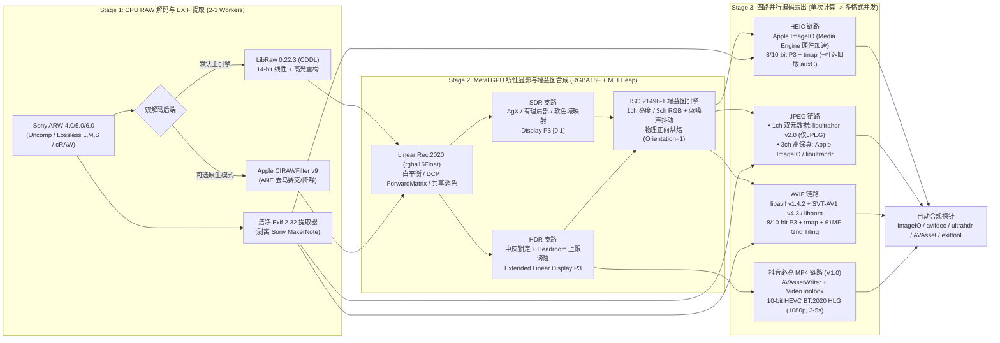

# 架构决策记录（ADR）：索尼 ARW 批量转 Apple HDR（`HDRPhoto`）

| 文档属性 | 内容 |
| :--- | :--- |
| **文档版本** | v1.1（已同步 PRD：「抖音必亮 10-bit HLG MP4 引擎」纳入 V1.0 基线） |
| **状态** | Accepted — Ready for Implementation |
| **关联文档** | [产品需求文档（PRD）](./PRD.md) · [第一轮前期技术调研报告](./RESEARCH.md) |
| **实测基准环境** | Apple Silicon / macOS 27.2（Build `26B123`）、Swift 6.4.2、`libavif 1.4.1/1.4.2`、`svt-av1 4.1.0/4.3.0`、`libultrahdr 2.0.2`、`libraw 0.22.3`、`exiftool 13.55` |

---

## 全局系统架构总览



---

## ADR-001：核心技术栈、模块化分层与零 GPL/LGPL 许可边界

- **状态**：Accepted
- **背景**：软件需要同时满足：① 61MP RAW 高速批量吞吐与 Apple Silicon 硬件编码加速；② 120Hz 原生 XDR/EDR 所见即所得预览；③ HEIC/JPEG/AVIF 三格式 100% ISO 21496-1 互通；④ 兼容闭源商业化及 Mac/iOS App Store 分发规范（严禁 GPL/LGPL 静态链接污染）。
- **决策**：
  1. **采用“macOS 原生分阶段模块化架构（Swift 6 + Metal + 零 GPL C/C++ XCFramework）”**：
     - 核心层 **`HDRPhotoCore`（无 UI 依赖 Swift Package）**：封装 RAW 解码桥接、Metal 计算着色器、ISO 21496-1 增益图算法、三链路编码器、EXIF 白名单序列化与 JSON Preset 模型。
     - 交付层 1：**`hdrphoto-cli`**（Phase 1 优先落地，验证核心吞吐与 CI 自动化回归）。
     - 交付层 2：**`HDRPhoto.app`**（Phase 2 SwiftUI + `MTKView`/`CAMetalLayer` 原生桌面端，零拷贝 120Hz EDR 预览）。
     - 未来演进：V2.0 可直接复用于 iPadOS/iOS App；若需 Windows 端，仅将纯数学 Metal Shader 翻译为 WGSL 并复用 C/C++ 编码库（`LibRaw` + `libultrahdr` + `libavif`）。
  2. **Phase 0 数值基线原型**：先用 3–5 天 Python（`rawpy` + `numpy` + `pyobjc`）建立黄金参考测试集，再落地 Swift/Metal 生产引擎。
  3. **严格许可合规白名单（零 GPL、零 LGPL）**：

| 组件 | 选定版本 | 许可证 | 用途与合规要点 |
| :--- | :--- | :--- | :--- |
| **`LibRaw`** | `0.22.3+` | **CDDL-1.0**（双许可中选 CDDL，不选 LGPL） | 索尼全系 ARW 解码；静态链接合规，保留版权与修改声明即可 |
| **Apple 系统框架** | macOS 15–27 SDK | Apple SDK | `Metal`、`CoreImage`、`ImageIO`、`CoreGraphics`、`AVFoundation`（HEIC 硬件编码 + EXIF + EDR 渲染） |
| **`google/libultrahdr`** | `v2.0.2+` | **Apache-2.0** | **强制编译开关 `-DUHDR_ENABLE_HEIF=OFF`**（仅编译 JPEG Ultra HDR 模块，**绝不拉入 LGPL-3.0 的 `libheif`**） |
| **`libjpeg-turbo`** | `3.x` | **BSD-3 / IJG / zlib** | `libultrahdr` 底层 SIMD JPEG 编解码 |
| **`AOMediaCodec/libavif`** | `v1.4.2+` | **BSD-2-Clause** | AVIF ISO 21496-1 `tmap` 容器 muxing 与 Grid Tiling |
| **`SVT-AV1`** | `v4.3.0+` | **BSD-3-Clause-Clear** | AVIF 默认极速多线程批量编码器（ARM NEON 优化 + `tune=iq`） |
| **`libaom`** | `v3.15.x` | **BSD-2-Clause** | AVIF 可选极致画质编码器（`AOM_TUNE_IQ` SSIMULACRA 2） |
| **`dav1d` / `libyuv`** | `1.5.x` / latest | **BSD-2 / BSD-3** | AVIF 内部验证解码与高速 YUV 色彩空间转换 |

- **被否决方案及原因**：
  - *Rust + Tauri + `libheif` + `x265` + `Exiv2`*：Tauri 在 macOS WKWebView 上存在帧率节流与 61MP 纹理 IPC 拷贝开销；`x265` 与 `Exiv2` 均为 **GPL-2.0**（传染闭源且违反 App Store 审核）；CPU `x265` 编码比 Apple Media Engine 慢 5–10×。
- **后果**：首期仅支持 macOS（精准覆盖绝大多数使用 Mac + iPhone + 索尼微单的核心用户），换取极高的工程稳定性、硬件编码性能与 100% 许可洁净度。

---

## ADR-002：索尼 ARW 双解码后端架构

- **状态**：Accepted
- **背景**：索尼现代机身涵盖 ARW 4.0/5.0/6.0，其中 **无损压缩 M / S** 为机内已去马赛克的 YCbCr 伪 RAW（RawSpeed/Darktable 不支持，旧版 Apple RAW 易偏色或失败）；另一方面，本机 macOS 27.2 实测 Apple `CIRAWFilter` 已覆盖 115 款索尼机身（含 A1 II、A9 III、A7 V），其中 18 款（A7 IV、A7R V、A7C II、A6700 等）支持 WWDC 2026 推出的 **RAW v9（ANE 神经网络去马赛克与降噪）**。
- **决策**：
  1. **主引擎（默认）：`LibRaw 0.22.3`（CDDL）**
     - 完整覆盖 Uncompressed、Lossless L、**Lossless M/S（`LIBRAW_RAWSPECIAL_SRAW_NO_RGB` / 自动识别 `as_shot_wb_applied` 标志避免二次白平衡）**、cRAW 与 ARW 6.0。
     - **严禁使用 `-H 0`（硬裁切至 1.0）**！必须以未裁切线性浮点（`-H 1` 或 `unpack()` 提取归一化 14-bit Bayer）送入自研 Metal 高光重构着色器（参考 darktable **`inpaint opposed`** 对向通道修复算法，辅以 LibRaw `-H 2` Blend / `-H 5` Rebuild 可选），彻底规避白平衡放大导致的洋红高光同时保留 `+1~+4 EV` 传感器高光余量。
  2. **可选副引擎（macOS 原生模式）：`Apple CIRAWFilter`**
     - 仅在用户显式勾选「Apple RAW v9 神经网络降噪」且当前文件受 `CIRAWFilter` 支持时启用。
     - 启用时强制配置：`baselineExposure = 0`、`shadowBias = 0`、`boostAmount = 0`、`localToneMapAmount = 0`、`extendedDynamicRangeAmount = 2.0`、`isHighlightRecoveryEnabled = true`（macOS 26+），并在支持机型上请求 `decoderVersion = .version9`（通过 `downloadResources(timeout:)` 按需拉取 ANE 模型），渲染至 `extendedLinearDisplayP3` `rgba16Float` 缓冲后检验最大像素值 `> 1.0`。
     - 若检测到索尼 Lossless M/S 或 `CIRAWFilter` 初始化返回 `nil`，无缝自动回退至 `LibRaw` 并记录日志。

---

## ADR-003：线性 HDR 工作空间与“中灰锁定双支路”色调映射管线

- **状态**：Accepted
- **背景**：实现“SDR/HDR 双端观感可控”，既要防止矩阵变换裁切广色域负值，又要保证 SDR 与 HDR 在暗部/中灰/肤色上严格一致（避免屏幕切换 HDR 时反差跳变或人脸“核辐射发光”），同时让 SDR 端拥有电影感高光滚降、HDR 端保留鲜艳高光。
- **决策**：
  1. **主工作空间**：**Linear Rec.2020 (D65)**，GPU 全程使用 **`MTLStorageModePrivate` + `rgba16Float`**（完整覆盖 Display P3 且零负值截断）；在增益图计算前统一经色相保持软色域映射转换至 **Extended Linear Display P3 (D65)**。
  2. **相机色彩矩阵管线**：优先解析 DCP 双光源插值 **`ForwardMatrix`** 直映 CIE XYZ (D50) → Bradford D50→D65 → Linear Rec.2020；缺失时回退 `ColorMatrix` + Bradford CAT。
  3. **DCP 与 3D LUT 的 HDR 保护规则**：
     - 加载 Adobe DCP 时**必须跳过 `[0, 1]` 范围的 `ProfileToneCurve`**（保留场景参考的 `HueSatDeltas` 与 `LookTable`，其中 `LookTable` 亮度索引钳位在 `1.0` 但不截断像素本身）。
     - 加载外部 `.cube` 3D LUT（V1.1）时，强制包裹在可逆 **Log Shaper**（如 `[-10 EV, +6 EV] → [0, 1]`）内部执行，绝不截断 `> 1.0` 的 HDR 高光。
  4. **中灰锁定双支路公式**：
     - 设共享场景调色与暗部/中灰曲线输出为 $x = f_{\text{mid}}(Y)$，拐点为 $P \in [0.65, 0.95]$（默认 $0.80$），拐点处导数斜率 $m = f'_{\text{mid}}(P)$：
       - 对 $x \le P$：**$f_{\text{hdr}}(x) = f_{\text{sdr}}(x) = x$**（确保中灰与肤色 $g = 0$）。
       - 对 $x > P$：采用 $C^1$ 连续有理肩部滚降函数：
         $$f(x;\; P, m, L_{\max}) = P + \frac{(L_{\max} - P)\cdot m(x - P)}{(L_{\max} - P) + m(x - P)}$$
       - **SDR 支路**：支持 `AgX`（Inset/Outset 矩阵消除高光霓虹偏色）、`OpenDRT` 或上述有理曲线（$L_{\max} = 1.0$），并叠加独立 SDR 曝光/高光压缩/饱和度微调参数。
       - **HDR 支路**：令 $L_{\max} = 2^{H_{\text{target}}}$（默认 $H_{\text{target}} = 2.5\text{ EV} \implies L_{\max} \approx 5.66$），高光向白退饱和权重显著弱于 SDR，保持霓虹/晚霞/蓝天色度。
  5. **软色域映射**：Rec.2020 → Display P3 转换采用 OKLab 色相保持软色域压缩（严禁简单 `max(rgb, 0)` 截断），输出非负线性 Display P3 值送入增益图合成。

---

## ADR-004：ISO/IEC 21496-1:2025 统一增益图计算引擎

- **状态**：Accepted
- **背景**：HEIC、JPEG、AVIF 三链路必须共用完全一致的增益图数学，且须规避 Headroom 单位混淆、Gamma 方向写反、8-bit 色带、暗部噪点放大与高反差光晕五大常见缺陷。
- **决策**：
  1. **强类型单位封装（编译期防混用）**：在 `HDRPhotoCore` 中定义独立值类型 `struct HeadroomStops { let log2Value: Double }` 与 `struct LinearHeadroom { let multiplier: Double }`，显式互转：
     - ISO 21496-1 二进制元数据 / `HDRToneMap` XMP / `libavif`：`baseHdrHeadroom`、`alternateHdrHeadroom` 仅接受 `HeadroomStops`（SDR = `0.0`，4× = `2.0`，5.66× = `2.5`）。
     - `CIImage.contentHeadroom` / `NSScreen` / `HDRGainMapHeadroom` XMP：仅接受 `LinearHeadroom`（SDR = `1.0`，+2 EV = `4.0`）。
  2. **严格编解码方程**（与 `avif.h`、`libultrahdr`、Apple ImageIO 交叉核验）：
     - 偏移量对称固定为 **$k_{\text{base}} = k_{\text{alt}} = 1/64 = 0.015625$**（保证 $W \to 0^+$ 时 $C^0$ 零跳变且抑制暗部底噪爆炸；中灰拐点 $P$ 以下区域施加平滑门限令 $g \to 0$）。
     - 原始对数增益：$G_c = \log_2\big((\max(H_c, 0) + k) / (\max(B_c, 0) + k)\big)$。
     - 紧致边界统计：按画面 `0.01%` 与 `99.99%` 分位数计算 $[g_{\min,c}, g_{\max,c}]$（防止热噪点浪费 8-bit 码级；若差值 $< 10^{-5}$ 则置平零增益）。
     - 归一化与 Gamma：**编码端 $M_{\text{enc}} = M_{\text{lin}}^{\gamma}$，解码端 $M_{\text{lin}} = M_{\text{enc}}^{1/\gamma}$**。
     - **防色带抖动**：8-bit 量化前强制施加 **蓝噪声 / TPDF 抖动** $Q = \operatorname{clamp}(\operatorname{round}(255 \cdot M_{\text{enc}} + d), 0, 255)$。
  3. **1ch vs 3ch 路由原则**：
     - **Apple 相册 / 存档 HEIC & AVIF**：默认 **3ch RGB**（精准还原 SDR 退饱和后的彩色高光）。
     - **小红书 / 抖音 / Android 14 双写 JPEG & iOS 14–17 双写 HEIC**：**强制 1ch 单色亮度图**（满足社交转码器、XMP `hdrgm:` 与 Apple 旧版 `auxC` 硬性约束）。
  4. **抗光晕下采样与闭环 SDR 补偿**：
     - 1/2 缩放增益图采用 **先在线性域双边/盒式下采样 $B$ 与 $H$ 再求比值**（而非直接缩小对数增益图跨边界模糊），显著降低树枝/建筑剪影光晕；同时提供 1:1 全尺寸选项。
     - 针对 8-bit JPEG 导出，提供**闭环 SDR 压缩补偿**（基于实际 JPEG 编码再解码后的 $\hat{B}$ 计算增益图），抑制 8-bit 4:2:0 块效应在高增益下放大。

---

## ADR-005：HEIC / JPEG / AVIF 三链路编码器路由架构（含 macOS 27.2 实测铁证）

- **状态**：Accepted
- **背景**：三种格式在 Apple 原生框架与开源生态上的成熟度、许可协议与标准合规性存在显著差异，不能“一刀切”使用同一套底层编码器。
- **决策（三链路精准分工）**：

| 输出链路 | 选定编码后端 | 核心调用方式 | 关键实测依据与选型理由 |
| :--- | :--- | :--- | :--- |
| **链路 1：HEIC (`.heic`)** | **Apple `ImageIO`** (`CGImageDestination`) | • 传 16-bit Display P3 `CGImage`（自动硬件编码为 **10-bit HEIC `Depth=10`**）或 8-bit `CGImage`<br>• 调用 `CGImageDestinationAddAuxiliaryDataInfo(dest, kCGImageAuxiliaryDataTypeISOGainMap, auxDict)`，元数据用 `HDRToneMap` XMP（1ch `'L008'` 或 3ch `'BGRA'`）<br>• 可选旧版兼容：同一次写入追加 `kCGImageAuxiliaryDataTypeHDRGainMap`（仅 1ch） | 1. 走 Apple Silicon **Media Engine 硬件 HEVC**，比 CPU `x265` 快 **5–10×** 且零 GPL。<br>2. 100% 原生契合 iOS 18–27 相册。<br>3. **避坑记录（macOS 27.2 实测）**：① 常量大小写差异：`kCGImageDestinationEncodeToISOGainmap`（小写 `m`）vs `kCGImageAuxiliaryDataTypeISOGainMap`（大写 `M`）；② macOS 26 未文档化子键（`EncodeGenerateGainMapWithBaseImage` 等）实测失效/静默忽略，故**不采用**，统一走 `AddAuxiliaryDataInfo` 方案；③ `libheif` 上游（至 1.22/1.23）仍未将 PR #1503 `tmap` 合入默认稳定构建，且默认 `x265` 为 GPL-2.0。 |
| **链路 2：JPEG (`.jpg`)** | **双模式路由**：<br>• **社交 / 1ch 双元数据（默认）**：**`google/libultrahdr` v2.0.2**（Apache-2.0，编译关 `UHDR_ENABLE_HEIF=OFF`）<br>• **3ch RGB 高保真**：**Apple `ImageIO`**（或 `libultrahdr` 关 `UHDR_WRITE_XMP`） | • **`libultrahdr` API-4 管线**：先用 `libjpeg-turbo` / ImageIO 压缩 8-bit Display P3（或 sRGB）SDR JPEG（嵌入 ICC、剥离 APP1 EXIF 防冲突）与 1ch 增益图 JPEG → `uhdr_enc_set_compressed_image` + `uhdr_enc_set_gainmap_image` + `uhdr_enc_set_exif_data`；编译开启 `-DUHDR_WRITE_ISO=ON -DUHDR_WRITE_XMP=ON`，置 `use_base_cg = 1`。<br>• **3ch RGB 模式**：走 Apple `ImageIO` `kCGImageAuxiliaryDataTypeISOGainMap`（`'BGRA'`）输出纯 ISO 21496-1 APP2 + MPF。 | 1. **本机实测确认**：Apple `ImageIO` 写 JPEG 时**不会**写入旧版 `hdrgm:` XMP（仅写 ISO 21496-1 APP2），会损失 Android 14 与部分依赖 XMP 的社交转码器兼容性。<br>2. `libultrahdr` v2.0.2（仅 JPEG 模块）为纯 Apache-2.0，完美实现 **Ultra HDR v1.1 双元数据（ISO APP2 + `hdrgm:` XMP + MPF）**，且修复了 `<v1.4` Display P3 矩阵误差与 ICC 溢出 Bug。<br>3. `hdrgm:` XMP 仅支持单通道，故 3ch RGB JPEG 必须关闭 XMP。 |
| **链路 3：AVIF (`.avif`)** | **`AOMediaCodec/libavif` v1.4.2（BSD-2）** + **`SVT-AV1` v4.3.0（BSD-3-Clear，批量默认）** / **`libaom` v3.15（BSD-2，画质档）** | • 直接构造 10-bit/8-bit `avifImage`（`AVIF_PIXEL_FORMAT_YUV420`，`AVIF_RANGE_FULL`，Display P3 CICP `12/13/6` + 一致 ICC）<br>• 挂载预计算 `avifGainMap`（8-bit `YUV400` 1ch 或 `YUV420` 3ch，`colorPrimaries=2`，`transferCharacteristics=2`，`AVIF_RANGE_FULL`，`useBaseColorSpace=AVIF_TRUE`）<br>• 经 `avifImageSetMetadataExif` 注入洁净 EXIF<br>• 依据 ADR-006 对 >4K/>8.9MP 图像调用 `avifEncoderAddImageGrid()` | **决定性本机 macOS 27.2 实测铁证**：<br>1. **为什么否决 macOS 27.2 原生 `ImageIO` `public.avif` 编码器？** 本机实测虽能在 0.61s 写出 61MP 10-bit `tmap` AVIF，但 Apple `ImageIO` 错误地将 `'pasp'` 等属性关联到 `'tmap'` 盒上，**被 `libavif` (`avifdec 1.4.1`) 直接拒收报错**（`Box[tmap] 'pasp', 'clap', 'irot' and 'imir' properties must be associated with base and gain map items instead of 'tmap'`），导致 Chrome/Edge/Android/Firefox 全部解析失败！此外 macOS 15 根本不支持编码 AVIF，且多图 `CGImageDestination(count: 2)` 返回 `nil`。<br>2. **为什么否决 `libultrahdr` v2.0 `AvifUltraHdr`？** 其底层依赖 **LGPL-3.0 的 `libheif`**（破坏零 LGPL 洁净边界）且缺少 61MP Grid Tiling 与 `SVT-AV1`/`tune=iq` 精细控制。<br>3. **反向双向实测通过**：本机用 `libavif` C API 生成的 10-bit Display P3 `tmap` AVIF，同时 **100% 无报错通过 `avifdec`（跨平台）与 macOS 27.2 Apple `ImageIO`（`hasISOGainMap=true`, `Depth=10`, `contentHeadroom=5.656854`）**！ |

---

## ADR-006：AVIF 超大分辨率（24MP–61MP）强制 Container Grid Tiling 规范

- **状态**：Accepted
- **背景**：索尼微单（尤其是 A7R V 61MP `9504 × 6336`）突破了 AVIF 单帧规范与硬件解码上限：
  1. **AVIF Baseline Profile（AV1 Main Level 5.1）**：单 coded item 上限 **`8192 × 4352` 且总像素 ≤ `8,912,896`（~8.9 MP）**；
  2. **`SVT-AV1` 硬编码上限**（已验证于 `EbSvtAv1Enc.h:268-283`）：`source_width ≤ 16384`，**`source_height ≤ 8704`** —— **竖构图 61MP（`6336 × 9504`）会直接崩溃/硬报错**！
  3. 移动端（A17 Pro+/M3/M4）硬件 AV1 解码器在超大单帧下会回退软件解码甚至 OOM。
- **决策**：
  1. **强制触发阈值**：凡输出尺寸满足 `width > 4096 || height > 4096 || (width * height) > 8_912_896` 时，**强制使用 `avifEncoderAddImageGrid(encoder, cols, rows, cells, AVIF_ADD_IMAGE_FLAG_SINGLE)`**（同时保留 `encoder->autoTiling = AVIF_TRUE`）。
  2. **索尼常见分辨率精确整除网格表**（竖构图自动互换 `cols`/`rows`，确保基础图与 0.5× 增益图均为严格偶数且无边缘余数）：

| 传感器分辨率 | 横构图网格 (`cols × rows`) | 基础图单格像素 | 0.5× 增益图单格像素 | Baseline 5.1 合规 |
| :--- | :---: | :---: | :---: | :---: |
| 24MP (`6000 × 4000`) | `2 × 2` | `3000 × 2000` (6.00 MP) | `1500 × 1000` | ✅ |
| 33MP (`7008 × 4672`) | `4 × 2` | `1752 × 2336` (4.09 MP) | `876 × 1168` | ✅ |
| 42MP (`7952 × 5304`) | `4 × 2` | `1988 × 2652` (5.27 MP) | `994 × 1326` | ✅ |
| **61MP (`9504 × 6336`)** | **`4 × 3`** | **`2376 × 2112` (5.02 MP)** | **`1188 × 1056`** | ✅（横/竖构图全通） |

  3. **任意裁剪尺寸通用算法**：计算 `cols = ceil(width / 2560)`、`rows = ceil(height / 2560)`，使内部格宽/高为 16 或 64 倍数，并校验最右/最底裁剪格在基础图与 0.5× 增益图上均满足 **MIAF 规则（`>= 64 px` 且为偶数）**；若边缘格 `< 64 px` 则递减 `cols`/`rows` 均分。
  4. **`libavif` Grid + Gain Map 强不变式**：① 基础图与增益图采用完全相同的 `cols × rows` 划分；② 每个 `cell[i]->gainMap` 挂载对应区域的增益图切块（零拷贝 `avifImageSetViewRect`），且所有 `cell[i]->gainMap` 的元数据分数（`gainMapMin/Max/Gamma`、offsets、headrooms、`useBaseColorSpace`）必须**比特级完全一致**；③ 强制要求 `libavif >= 1.3.0`（推荐 `1.4.2`，包含 `tmap` + `grid` `ispe` 修复）。
  5. **防硬件解码回退**：AVIF 主图默认固定 **10-bit `YUV420`**（AV1 Main Profile），禁止默认使用 12-bit 或 `YUV444`。

---

## ADR-007：iOS 27 原生一致性与多生态元数据安全策略

- **状态**：Accepted
- **背景**：直接读取本机 macOS 27.2 SDK (`PhotosTypes.h`, `CIImage.h`)、ExifTool 13.55 表并在 macOS 27.2 实测了双写行为与 MakerNote 公式，得出多条必须硬编码进架构的强约束。
- **决策**：
  1. **HEIC 增益图策略**：
     - **默认（iOS 18–27 推荐）**：仅写纯净 **ISO 21496-1 `tmap`**（支持 1ch 或 3ch RGB，与 Apple `CIContext` 行为一致，无需伪造 Apple MakerNote，在 iOS 27 相册激发与原相机完全一致的 EDR）。
     - **可选双写（兼容 iOS 14–17）**：仅当增益图为 **1ch 单色 (`L008`)** 时允许启用！在同一次 `CGImageDestination` 中先写 `kCGImageAuxiliaryDataTypeISOGainMap` 再写 `kCGImageAuxiliaryDataTypeHDRGainMap`（用 XMP `HDRGainMap:HDRGainMapVersion=131072` + `HDRGainMap:HDRGainMapHeadroom=<linear>` 无需伪造 MakerNote）。**实测强制约束**：① Apple ImageIO 底层会共用同一条增益图码流且 `ISOGainMap` 像素总是覆写 `HDRGainMap` 像素，因此启用双写时必须锁定 `gainMapMin = 0`、`gainMapMax = log2(H)` 使两端点对齐、减小旧设备 Rec.709 vs log2 曲线偏差；② **严禁在 3ch RGB 增益图下启用双写**（本机实测会触发 ImageIO 崩溃/段错误！）。
  2. **JPEG 元数据红线**：
     - **严禁向 log2 编码的 ISO 21496-1 / Ultra HDR JPEG 注入 Apple MakerNote 33/48**（Apple 旧版采用线性乘数 Rec.709 曲线，与 log2 数学冲突）。
     - 若需兼容旧版 Apple MakerNote 计算（仅排查用），注意本机实测发现 `maker33 == 0.0` 会令 ImageIO 禁用 HDR 返回 `1.0`。
  3. **iOS 静态图 HDR 标签诚实处理**：
     - iOS 18–27 相册原生不显示静态 HDR 角标，也无 HDR 媒体类型相簿；仅在用户主动开启高级选项时写入 EXIF `CustomRendered = 3` (`0xA401`) 供 macOS Photos 桌面端智能相簿归类。
  4. **EXIF 白名单与方向烘焙铁律**：
     - 全链路严禁透传原始索尼 `MakerNote` (`0x927C`，防 64 KB JPEG APP1 溢出与坏偏移）；通过自研轻量化 Exif 2.32 白名单构建器（< 8 KB）在**编码期**注入（绝不事后调用外部工具破坏 MPF/`tmap`）。
     - 像素在进入编码器前全部按原 EXIF Orientation 完成物理旋转/翻转，输出 EXIF 强制写 **`Orientation = 1`**（杜绝增益图错位重影）。

---

## ADR-008：社交平台（小红书 / 抖音）适配边界与 V1.0 抖音 10-bit HLG 动态图引擎

- **状态**：Accepted
- **背景**：小红书 CDN（腾讯云 CI `imageMogr2/hdr`）支持 Ultra HDR JPEG / Apple GainMap HEIC；字节火山引擎 `veImageX`（2025-05-14 发布）明确限定 Gainmap 仅在 **JPEG → JPEG 且仅做缩放** 时保留，导致抖音图文静态照当前绝大多数仍被剥离为 SDR，但抖音 **10-bit HLG / 杜比视界视频** 100% 稳定激发 OLED HDR。根据产品拍板，将该引擎提前纳入 **V1.0** 一并交付。
- **决策**：
  1. **社交预设参数由可热更新 JSON Schema 驱动**（便于平台规则变动时快速调整，无需重发二进制）。
  2. **小红书 Preset 硬护栏**：强制路由至 **`libultrahdr` 1ch 单色 Ultra HDR v1.1 JPEG（Display P3 ICC，1/2 缩放，ISO APP2 + `hdrgm:` XMP + MPF）**，自动限制长边 ≤ `2048 px`、目标体积 ≤ `4 MB`（超限时自动阶梯微降 Q 值重试一次），禁止 3ch RGB 与 AVIF 混入该预设。
  3. **抖音图文 Preset 硬护栏**：路由至 `libultrahdr` 1ch 单色 Ultra HDR v1.1 JPEG（默认 `sRGB` ICC，长边 ≤ `1920 px`，≤ `3 MB`），并在色调映射层强制保证 SDR 基础图具备独立完整的反差与饱和度。
  4. **V1.0 抖音必亮 HDR 动态图子引擎 (`HLGVideoEncoder`)**：
     - 复用 macOS 原生 **`AVAssetWriter` + `VideoToolbox`**（零额外依赖、Apple Silicon 硬件 Main10 编码）。
     - 输出规格：`.mp4`，`AVVideoCodecType.hevc` + `kVTProfileLevel_HEVC_Main10_AutoLevel`，`AVVideoColorPropertiesKey` 显式写 `ITU_R_2020` / `ITU_R_2100_HLG` / `ITU_R_2020`，像素缓冲 `kCVPixelFormatType_420YpCbCr10BiPlanarVideoRange`（10-bit Video Range 兼容度最高）。
     - 色彩与光传映射：Metal Shader 将 `Extended Linear Display P3` HDR 纹理转换至 `Linear BT.2020` 并应用标准 **ITU-R BT.2100 HLG OETF**（漫反射白 `1.0` 锚定约 75% HLG 电平，峰值约 `~2.5–3.0 EV` / 1000–1600 nits 平滑滚降）。
     - 分辨率与码率护栏：锁定 **`1080×1920 (9:16)`** 或 **`1080×1440 (3:4)`**（严禁导出 4K 防抖音二次重压毁画质），时长 `3–5s`（默认 4s），`30 fps`，目标码率 `12–16 Mbps`。

---

## ADR-009：61MP 高吞吐有界三阶段并行流水线与显存池化

- **状态**：Accepted
- **背景**：A7R V 61MP（`9504 × 6336`）若采用 `RGBA32F` 且无背压并发，单张峰值内存近 2 GB，16 GB Mac 极易 OOM 崩溃。
- **决策**：
  1. **全程 GPU `rgba16Float`（单帧 482 MB，立省 50% 显存）**，配合按分辨率分桶的 **`MTLHeap` 纹理池** 零分配复用。
  2. **有界三阶段 Swift Concurrency 流水线（`AsyncStream` + 显式信号量背压）**：
     - **Stage 1（CPU 解码池，2–3 并发）**：`LibRaw` 实例池，限制单实例 OpenMP 线程防止核间争抢；送入容量=`2` 的有界通道。
     - **Stage 2（GPU Metal 管线，2-deep 命令队列）**：单次完成线性显影 → SDR Base + HDR Alt → 增益图计算与物理旋转烘焙，每帧包裹 `autoreleasepool {}`；送入容量=`2` 的有界通道。
     - **Stage 3（编码扇出池，2 并发）**：同一份 `RenderedFrame` 并发扇出至用户勾选的 `HEIC`（Media Engine）、`JPEG`（`libultrahdr`）、`AVIF`（`libavif` + `SVT-AV1`），原子写盘（`.tmp` → `rename`）并触发轻量校验。
  3. **动态内存并发预算**：启动时读取 `ProcessInfo.processInfo.physicalMemory` 与源图百万像素数——16 GB RAM 机器限制 61MP 总在途帧数 `≤ 2`（目标峰值常驻内存 ≤ 4.5 GB）；32 GB+ 放宽至 `3–4`。

---

## ADR-010：原生 120Hz EDR 实时预览与 CI 自动化三格式验收体系

- **状态**：Accepted
- **背景**：需要让用户在普通屏与 XDR 屏上都能准确预览 iPhone 实际观感，并确保每次代码提交都不会破坏任一格式的 ISO 21496-1 合规性。
- **决策**：
  1. **EDR 预览架构**：SwiftUI 通过 `NSViewRepresentable` 封装 `MTKView`（`wantsExtendedDynamicRangeContent = true`、`.rgba16Float`、`extendedLinearDisplayP3`），监听 `NSScreen.maximumExtendedDynamicRangeColorComponentValue` 与屏幕参数通知。交互期加载 LibRaw `half_size` 代理图（~3MP / 25 MB），Fragment Shader 实时执行 **ISO 21496-1 真实量化 + 逆向解码公式**，支持 `1×/2×/4×/8×` Headroom 模拟、滑动分屏、假彩色热力图、双区直方图与 `G` 键 Gain Map 直视。
  2. **CI 自动化合规回归门禁（每次 PR/发版必跑）**：
     - **通用 Apple 探针（HEIC + JPEG + AVIF 全查）**：Swift `ImageIO` 测试断言 `kCGImageAuxiliaryDataTypeISOGainMap != nil`、`kCGImageSourceDecodeToHDR` 后 `contentHeadroom` 与配置值误差 `< 2%`、核心 EXIF 完整且 `Orientation == 1`。
     - **HEIC 专项**：`MP4Box -info` 验证 `ftyp` 含 `tmap`、`iinf` 含 `tmap`、`iref` 含 `dimg`、`grpl` 含 `altr`。
     - **JPEG 专项**：`ultrahdr_app -P` 零错误 + `exiftool -G1 -a -s -ee` 校验 `urn:iso:std:iso:ts:21496:-1`、`MPF`、Display P3/sRGB ICC 及单通道预设下的 `XMP-hdrgm`。
     - **AVIF 专项**：**强制双向门禁**——`avifdec --info --depth 16`（零 `tmap` 盒违规错误）+ `avifgainmaputil printmetadata` + Apple `ImageIO` 探针，并专门包含 **61MP 竖构图（`6336×9504`）** 用例验证 `3×4` Grid Tiling。
     - **抖音 HLG MP4 专项（V1.0）**：`AVAssetTrack.formatDescriptions` / `ffprobe` 校验 `hevc (Main 10)`、`bt2020` Primaries、`arib-std-b67` Transfer、`yuv420p10le`、`1080×1920` 或 `1080×1440` 与 3–5s 时长。

---

## 附录 A：工程目录与 SwiftPM 模块蓝图

```text
HDRPhoto/
├── Package.swift                      # Swift 6 Package（Core + CLI + Tests）
├── Vendor/                            # 零 GPL/LGPL 原生库构建脚本与 XCFramework
│   ├── build_deps.sh                  # CMake 构建：LibRaw(CDDL), libultrahdr(仅JPEG), libavif+SVT-AV1+libaom+dav1d+libyuv
│   └── XCFrameworks/
│       ├── LibRaw.xcframework
│       ├── LibUltraHDR.xcframework    # -DUHDR_ENABLE_HEIF=OFF -DUHDR_WRITE_ISO=ON -DUHDR_WRITE_XMP=ON
│       └── LibAVIF.xcframework        # libavif 1.4.2 + SVT-AV1 4.3 + libaom 3.15 + dav1d 1.5
├── Sources/
│   ├── CLibRawBridge/                 # 极薄 C 封装：ARW 线性解包、M/S YCC 识别、白名单 EXIF 提取
│   ├── CUltraHDRBridge/               # 极薄 C 封装：API-4 预压缩 JPEG + 增益图 + EXIF 封装
│   ├── CLibAVIFBridge/                # 极薄 C 封装：10-bit YUV420 + tmap + 61MP Grid Tiling
│   ├── HDRPhotoCore/                  # 无 UI 核心引擎（可复用于 CLI / macOS App / iOS App）
│   │   ├── Models/                    # PresetSchema(JSON), HeadroomStops, LinearHeadroom, ExportJob
│   │   ├── Decode/                    # ARWDecoderProtocol, LibRawDecoder, CIRAWv9Decoder
│   │   ├── ColorMetal/                # Shaders.metal (Opposed Inpaint, DCP, AgX, MidtoneLock, ISO GainMap, HLG OETF, BlueNoise)
│   │   ├── Encode/                    # HEICImageIOEncoder, JPEGDualEncoder, AVIFGridEncoder, HLGVideoEncoder, ExifWhitelistBuilder
│   │   ├── Pipeline/                  # BoundedBatchPipeline, MTLHeapTexturePool, MemoryBudgetScheduler
│   │   └── Verify/                    # ISO21496Probe, HLGVideoProbe (导出后自动化合规校验)
│   └── HDRPhotoCLI/                   # Phase 1 批量命令行工具 (`hdrphoto-cli`)
├── App/                               # Phase 2 macOS 原生桌面端 (`HDRPhoto.app`, SwiftUI + MTKView EDR)
├── Presets/                           # 内置 JSON 预设（apple_heic, xiaohongshu_jpg, douyin_jpg, douyin_hlg_mp4, tri_format, avif_archive）
├── Scripts/                           # Phase 0 Python 数值原型 & CI 校验脚本 (exiftool/avifdec/MP4Box/ultrahdr_app)
└── Tests/
    └── HDRPhotoCoreTests/             # ISO 21496-1 数学单元测试、61MP Grid 单元测试、三格式双向合规集成测试
```
