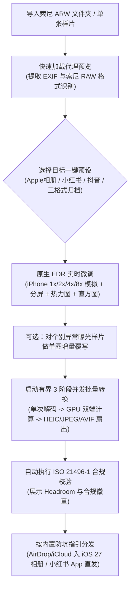

# 产品需求文档（PRD）：索尼 ARW 批量转 Apple HDR 专业工具（代号：`HDRPhoto`）

| 文档属性 | 内容 |
| :--- | :--- |
| **文档版本** | v1.1（已确认基线：「抖音必亮 10-bit HLG MP4」提前纳入 V1.0） |
| **目标系统基线** | 主端：macOS 15–27（Apple Silicon 优先，实测验证基线 macOS 27.2）；目标观看端：iPhone iOS 18 / 26 / 27、Android 14–17、Windows/Web |
| **核心标准** | **ISO/IEC 21496-1:2025（Adaptive HDR / Gain Map）** 覆盖 **HEIC / JPEG / AVIF** 三链路 + **ITU-R BT.2100 HLG（10-bit HEVC MP4）** 覆盖抖音必亮动态图 |
| **关联前置文档** | [第一轮前期技术调研报告](./RESEARCH.md) · [系统架构决策记录（ADR）](./ADR.md) |

---

## 1. 产品背景、用户痛点与预期对齐

### 1.1 背景痛点
1. **索尼相机 HLG 直出 `.HIF` 在 iPhone 上水土不服**：索尼机身直出的 10-bit BT.2020 HLG `.HIF` 是单流静态 HDR，无 SDR 基础图与 Gain Map，且将漫反射白定在 75% 信号位并依赖显示端 OOTF；在 iOS 非端到端 HLG 场景（缩略图、分享、社交 App）极易丢失 OOTF/EDR 扩展导致**画面发灰、对比度低或高光硬切**。
2. **现有修图生态断层**：Lightroom/ACR 至今无法原生直出 ISO 21496-1 HEIC 且订阅重、批量慢；Capture One/DxO 不支持消费级 Gain Map 导出；Photomator 依赖 Apple RAW 导致索尼无损压缩 M/S 支持受限且缺乏独立 SDR/HDR 双端曲线与批量 CLI；社区 CLI 仅处理已显影的 TIFF/EXR/HIF，缺失从 **14-bit 索尼 `.ARW` 到三格式 ISO 21496-1 HDR 的一站式批量工具**。

### 1.2 用户核心预期与平台客观事实对齐

> [!IMPORTANT]
> 本产品以**实证工程事实**为前提，明确区分“100% 可工程保证的能力”与“受限于第三方平台策略的客观边界”，避免交付落差：

| 用户核心预期 | 平台实证现状（2026 年底基线） | 产品落地策略 |
| :--- | :--- | :--- |
| **预期 1：iOS 相册观感与 iPhone 原相机直出一致（含激发 HDR 与 HDR 标签）** | 1. **EDR 激发观感 100% 一致**：iOS 18/26/27 原生相册、快速查看、锁屏壁纸与 iCloud 同步均以 **ISO/IEC 21496-1 `tmap` HEIC** 为一等公民，纯 ISO `tmap` 无需伪造 Apple MakerNote 即可呈现与 iPhone 原相机完全一致的平滑 EDR 亮度激发。 2. **关于“HDR 标签”的客观事实**：经查验 macOS/iOS 27 SDK (`PhotosTypes.h`)，Apple 自现代 Smart HDR 时代起**已取消 iOS 照片 App 静态图的左上角 `HDR` 角标与“HDR 媒体类型”相簿**（如今 iPhone 原相机直出的静态 HDR 照片同样不显示角标，仅 **HDR/杜比视界视频** 显示 `HDR` 标识；仅 macOS Photos 桌面端保留基于旧版 EXIF `CustomRendered=3` 的 `Photo is HDR` 智能相簿）。 | • 默认输出纯净 **ISO 21496-1 `tmap` HEIC**（10-bit Display P3 基础图 + 8-bit 增益图），与 Apple 官方管线完全一致。 • 提供可选 **「兼容旧版 Apple 设备（iOS 14–17）」** 开关（单通道 HEIC 双写 `HDRGainMap` 辅助图 + `HDRGainMapHeadroom` XMP）。 • 提供可选 **「写入 macOS 相册 HDR 归类标签 (`CustomRendered=3`)」** 开关，并在 UI 清晰说明 iOS 27 静态图原生无角标机制。 • 内置导出后合规校验徽章 + AirDrop/iCloud 正确传图指引，杜绝传输剥离增益图。 |
| **预期 2：上传抖音、小红书能触发 HDR 效果** | 1. **小红书（高可行性）**：云端（腾讯云 CI `imageMogr2/hdr`）与移动端已支持 Gain Map HDR。实证存活率最高的是 **Ultra HDR v1.1 JPEG（ISO 21496-1 APP2 + XMP `hdrgm:` + MPF，强制 1 通道单色增益图，Display P3，长边 ≤ 2048px，≤ 4MB）**，且必须经**最新版小红书 App 直接从相册上传、严禁网页端与站内二次编辑/滤镜/裁剪**。 2. **抖音图文（受限现状）**：虽然字节火山引擎 `veImageX` 已于 2025 年 5 月上线 JPEG→JPEG Gainmap 保留能力（且仅限单纯缩放），但目前**抖音图文静态照绝大多数情况下仍会被服务端重编码并剥离 Gain Map 降级为 SDR**；唯独 **抖音 10-bit HLG / 杜比视界短视频管线** 100% 稳定激发 OLED HDR！ | • **V1.0 内置「小红书 HDR（推荐）」一键预设**：强制锁定 Ultra HDR v1.1 JPEG + 1ch 增益图 + 2048px/3:4 护栏 + 操作防坑提示。 • **V1.0 内置「抖音图文 HDR 兼容」一键预设**：输出符合 `veImageX` 规范的 JPEG，并依靠**双端观感可控引擎**保证即便被降级 SDR 依然通透饱满、绝不发灰，同时前向兼容抖音后续开放图文透传。 • **V1.0 同步内置「抖音必亮 HDR 动态图（10-bit HLG MP4）」一键预设**：一键将静态 HDR 图封装为 3–5 秒 1080p 10-bit HLG HEVC 视频，通过抖音视频管线 **100% 稳定触发高亮 HDR**！ |
| **预期 3：跨平台输出 HEIC、JPEG、AVIF 三种格式** | 三格式各有最优生态位：**HEIC**（iPhone/macOS/iCloud 相册最佳）、**JPEG**（小红书/Android 14–17/Chrome/Windows 通用最佳）、**AVIF**（未来高压缩 10-bit 归档与次时代 Web 最佳；注：macOS 27/iOS 27 Photos 与 Adobe 支持 HDR，Chrome 当前为 flag 门控/默认回退 SDR，Firefox 回退 SDR，社交平台拒收 AVIF）。 | **V1.0 即完整实现三链路输出（单次 ARW 解码 + 单次 GPU 计算 → 并行扇出 HEIC / JPEG / AVIF 任意组合）**，均严格遵循 ISO/IEC 21496-1:2025，并通过 `libavif`（配 61MP Grid Tiling）保证 AVIF 在 Apple 与 Chrome/Android 两端双合规。 |

---

## 2. 目标用户画像与核心场景

| 用户画像 | 核心诉求 | 高频工作流 |
| :--- | :--- | :--- |
| **P1：索尼微单 + iPhone 摄影爱好者** | 用 α7 IV / α7R V / α7C II / α6700 / A1 / A9 III 拍完一次旅行或扫街（50–500 张 `.ARW`），希望在 Mac 上 5 分钟内批量转出能在 iPhone 相册“一眼通透点亮”的 HDR 照片，同时普通电脑/微信查看不发灰。 | 拖入整个 SD 卡 ARW 文件夹 → 挑 1 张代表图在 Mac XDR 屏微调 SDR/HDR 双端参数 → 套用批量 Preset → 一键导出 10-bit HEIC → AirDrop/iCloud 入 iPhone 相册。 |
| **P2：小红书 / 抖音视觉内容创作者** | 需要针对社交平台苛刻的分辨率、体积、单通道增益图与元数据规则一键直出合规 HDR 成品，避免反复踩坑发灰。 | 选定「小红书 HDR」或「抖音图文 / V1.1 抖音必亮动态图」预设 → 批量裁剪统一画幅（3:4 / 9:16）并导出 → 按内置指引经 iOS App 直发。 |
| **P3：多端归档与跨平台分享用户** | 既要在 iPhone 上看 HEIC，又要给 Windows/Android 朋友发 JPEG，还要保留极小体积 10-bit AVIF 归档或发个人摄影站。 | 勾选「HEIC + JPEG + AVIF 同步输出」→ 一次解码并行输出三套完全同源的 ISO 21496-1 成品。 |

---

## 3. 版本规划与范围界定（Roadmap）

| 阶段 | 交付形态 | 核心范围（In-Scope） | 暂不包含（Out-of-Scope） |
| :--- | :--- | :--- | :--- |
| **Phase 0：算法验证原型**（3–5 天） | 内部 Python + Swift 校验脚本 | 用真实索尼 ARW 样片跑通线性显影、双支路色调映射、HEIC/JPEG/AVIF 三链路编码与 iPhone iOS 27 真机 / 小红书实测验收。 | GUI、批量队列管理 |
| **V1.0（MVP 生产版）** | **核心引擎 `HDRPhotoCore` + 高速批量 CLI `hdrphoto-cli` + macOS 原生桌面 App (`HDRPhoto.app`)** | • 全系索尼 ARW（含无损 M/S、ARW 6.0）解码 + 可选 Apple RAW v9 • SDR/HDR 双端观感可控管线（AgX/中性有理曲线 + 独立 SDR/HDR 参数） • **HEIC / JPEG / AVIF 三链路 ISO 21496-1 输出**（支持单次解码多格式并发） • **「抖音必亮 HDR 动态图（10-bit HLG HEVC MP4）」一键硬件封装**（3–5s 1080p，直通抖音 HDR 视频管线） • 原生 120Hz EDR 实时预览（Headroom 模拟滑块、分屏对比、热力图、双区直方图、Gain Map 检视） • 内置 Apple 相册 / 小红书 / 抖音图文 / 抖音 HLG 动态图 / AVIF 归档预设 + JSON 预设导入导出 + 单图增量覆写 • EXIF 安全迁移 + 导出自动合规校验徽章 | 局部画笔/蒙版精修（非完整 Lightroom 替代品）、复杂多轨视频剪辑、云端同步、Windows GUI |
| **V1.1（色彩与效率增强版）** | macOS App + CLI 升级 | • 索尼 Creative Look（ST/NT/VV/FL/IN）精准色彩预设 + Adobe `.dcp` / 外部 `.cube` 3D LUT（Log-Shaper HDR 保护）导入 • 相机镜头配置文件畸变/暗角校正 • 一键批量发送至 macOS「照片」App / 隔空投送快捷入口 • 抖音 HLG 动态图进阶选项（多图幻灯片连拼、轻微缓推 Ken Burns 动效） | 视频剪辑时间线 |
| **V2.0（跨端扩展版）** | 可选扩展 | • iPadOS / iOS 伴侣 App（外接读卡器现场直转入 iPhone 相册，直接复用 `HDRPhotoCore`） • 视需求移植核心 Shader 至 Windows 端（DX12 + `libultrahdr` + `libavif`） | — |

---

## 4. 功能需求详述（Functional Requirements）

### FR-01：索尼 ARW 批量导入与双后端解码
- **输入支持**：支持拖拽单张/多张 `.ARW` 文件、递归扫描文件夹（支持过滤子目录与去重）。
- **全压缩模式覆盖**：完整支持索尼 **Uncompressed（未压缩）**、**Lossless Compressed L（无损大）**、**Lossless Compressed M / S（YCbCr 伪 RAW）**、**Compressed（cRAW）** 及 **ARW 6.0（含 A7 V）**，覆盖 A7 IV、A7R V、A7C II、A6700、A1 / A1 II、A9 III、FX3、ZV-E1 等全系主流机身。
- **双解码后端切换**：
  - **默认引擎（`LibRaw 0.22+`）**：14-bit 确定性线性解码 + 自定义无裁切高光重构（规避洋红高光与 `-H 0` 高光抹平），100% 兼容索尼无损 M/S。
  - **可选原生引擎（`Apple CIRAWFilter`）**：在 macOS 27+ 且支持的 18 款索尼机身上，可选启用 **RAW v9（ANE 神经网络去马赛克与降噪）**；当遇到不支持的 M/S 压缩文件时自动回退至 LibRaw 并给出轻量提示。

### FR-02：线性 HDR 显影与“SDR/HDR 双端观感可控”参数体系
所有图像处理先在宽色域线性浮点空间完成共享场景级调色，再基于 **中灰锁定双支路架构** 分别产出 SDR 基础图与 HDR 目标图，支持以下分级控制：

| 参数分组 | 可调项与范围 | 默认值 | 设计目标 |
| :--- | :--- | :--- | :--- |
| **1. 基础显影（双端共享）** | 白平衡（拍摄原值 / 色温 2000–15000K / 色调 -150~+150）、基础曝光（-3.0 ~ +3.0 EV）、阴影恢复（0 ~ 100）、黑位微调、自然饱和度、高光重构模式（Opposed Inpaint / Blend / Rebuild）、相机色彩配置（标准 / DCP / V1.1 索尼风格 & `.cube` LUT） | 拍摄原值 / 0 EV / Opposed Inpaint | 在分叉前建立准确的线性场景参考，确保双端影调与色相统一 |
| **2. SDR 端独立控制（SDR 观感）** | **SDR 映射曲线**（`AgX` / `中性有理肩部` / `OpenDRT`）、**SDR 曝光微调**（-1.0 ~ +1.0 EV）、**SDR 高光压缩强度**（0 ~ 100）、**SDR 对比度 & 饱和度补偿** | `AgX` / 0 EV / 50 | 保证普通 SDR 屏幕、微信缩略图、被抖音剥离增益图后的观感通透自然、绝不发灰 |
| **3. HDR 端与增益图控制（HDR 观感）** | **目标 HDR Headroom 上限**（`+1.0` ~ `+4.0 EV`）、**中灰/肤色锚定拐点 $P$**（`0.65` ~ `0.95`）、**高光激发力度**（0 ~ 100）、**高光滚降柔和度**、**增益图通道模式**（`1ch 单色亮度` / `3ch RGB 彩色`）、**增益图分辨率**（`1/2 缩放` / `1:1 全尺寸`）、**Gamma 分配**（默认 `1.0`） | `+2.5 EV` / 锚点 `0.80` / 随预设切换通道与分辨率 | 精确控制高光“点亮”幅度，锁定人像肤色 ≤ 1.0 避免“发光脸”，3ch 模式保留霓虹/晚霞高饱和色相 |
| **4. 构图与画幅护栏** | 目标比例裁剪（原图 / 3:4 / 4:5 / 1:1 / 4:3 / 9:16，支持批量居中或单图微调）、最大长边缩放（原尺寸 / 4096 / 2048 / 1920 / 自定义） | 原图 / 原尺寸 | 一步到位满足小红书 3:4 / 2048px 与抖音 9:16 / 1920px 防服务端裁切要求 |

### FR-03：原生 120Hz EDR 实时预览与双端检视工具
- **真实 EDR 画布**：在支持 XDR/HDR 的 Mac 显示器上实时激发 >1.0 亮度，交互拖滑块帧率 **≥ 60 fps**（单帧预览响应 < 16 ms）。
- **所见即所得（WYSIWYG）ISO 21496-1 模拟**：预览管线实时执行与 iPhone 相同的 ISO 21496-1 量化与逆向解码公式，提供 **iPhone 屏幕 Headroom 模拟档位**：
  - `1.0× (0 EV)` — 纯 SDR 回退观感
  - `2.0× (+1 EV)` — 户外强光 iPhone 观感
  - `4.0× (+2 EV)` — 室内日常 iPhone Pro XDR 观感
  - `8.0× (+3 EV)` — 暗室峰值 XDR 观感
  - **SDR 外接显示器降级辅助**：当检测到当前屏幕最大 EDR = `1.0×` 时，显示顶部提示并提供 **「曝光缩放检视」** 开关（将画面乘以 $1/H_{\text{sim}}$ 以无裁切查看高光滚降层次）。
- **4 大专业检视模式**：
  1. **同屏滑动分屏对比**（左半屏强制 $W=0$ 纯 SDR，右半屏实时 EDR 激发）；
  2. **Headroom 假彩色热力图**（分色标出 `0~1 EV`、`1~2 EV`、`2~3+ EV` 及传感器硬裁切区）；
  3. **双区直方图**（醒目标注 `0 EV` SDR 白点边界，右侧展开 `+1/+2/+3/+4 EV` HDR 能量分布）；
  4. **Gain Map 直视图**（快捷键 `G` 一键查看生成的单色/RGB 增益图，排查光晕与暗部噪点）。

### FR-04：HEIC / JPEG / AVIF 三链路输出规格
允许用户勾选 **1 种、2 种或全部 3 种格式同步输出**（单次解码 + 单次 GPU 计算，三路并发编码）：

| 输出格式 | 基础图规格 | 增益图与容器规范 | 默认定位与特色选项 |
| :--- | :--- | :--- | :--- |
| **HEIC (`.heic`)** | **10-bit（默认）** 或 8-bit Display P3 / sRGB | ISO/IEC 21496-1 **`tmap`**（`ftyp` 含 `tmap`、`dimg`、`altr`）；8-bit 1ch 或 3ch 增益图（1/2 或 1:1） | **Apple 生态主力**：Apple Silicon 硬件加速；支持可选开关 **「双写 iOS 14–17 旧版 Apple `HDRGainMap`」**（开启时强制单通道增益图） |
| **JPEG (`.jpg`)** | 8-bit Display P3 或 sRGB（嵌 ICC） | **模式 A（默认/社交通用）**：**Ultra HDR v1.1 双元数据**（ISO 21496-1 `APP2` + XMP `hdrgm:` + `MPF`，1ch 单色 1/2 增益图） **模式 B（高保真 3ch）**：纯 ISO 21496-1 `APP2` + `MPF`（3ch RGB 增益图，不写冲突的 `hdrgm:` XMP） | **跨平台 & 小红书/Android/Chrome 主力**：支持闭环 SDR 压缩误差补偿（消除 8-bit 块效应在高增益下放大）；**严禁写入冲突的 Apple MakerNote 33/48** |
| **AVIF (`.avif`)** | **10-bit（默认）** 或 8-bit Display P3 / sRGB（全范围 `YUV420`，CICP + ICC 一致） | 标准 ISO/IEC 21496-1 **`tmap`**（`ftyp` 含 `tmap`、`altr`、`grid`）；8-bit 1ch `YUV400` 或 3ch `YUV420`；**>4K / >8.9MP 自动启用 MIAF Baseline 5.1 Grid Tiling** | **未来高压缩归档 & 次时代 Web**：提供 **「极速批量 (`SVT-AV1`)」** 与 **「极致画质 (`libaom tune=iq`)」** 编码档位切换；100% 通过 Apple ImageIO 与 `libavif` (Chrome/Android) 双重验证 |
| **抖音必亮动态图 (`.mp4`)** | **10-bit HEVC (Main10) BT.2020 HLG**（Video Range，1080×1920 或 1080×1440） | 非 Gain Map 封装；直接由线性 HDR 纹理映射至标准 ITU-R BT.2100 HLG（漫反射白锚定 75% 电平），3–5 秒可调时长，30 fps，12–16 Mbps | **抖音 100% 必亮主力**：复用 Apple Silicon VideoToolbox 硬件编码；规避 4K 压制与抖音图文剥离 Gain Map 限制，配合抖音 iOS App「高清发布」稳定激发高亮 HDR |

### FR-05：内置一键预设矩阵（开箱即用）

| 预设名称 | 输出格式 | 位深 & 色域 | 增益图策略 | 分辨率 & 体积上限 | 目标 Headroom | 专属护栏与 UI 提示 |
| :--- | :--- | :--- | :--- | :--- | :---: | :--- |
| **1. Apple 相册原生高保真（默认）** | `HEIC` | 10-bit Display P3 | **3ch RGB**，1/2（可选 1:1），纯 ISO `tmap` | 原尺寸 / Q=90 | `+2.5 EV` | 推荐经 AirDrop 或 iCloud 相册传至 iPhone，观感与原相机一致 |
| **2. Apple 兼容全代（含 iOS 14–17）** | `HEIC` | 10-bit Display P3 | **1ch 单色**，1/2，ISO `tmap` + 旧版 `HDRGainMap` 双写 | 原尺寸 / Q=90 | `+2.5 EV` | 兼顾旧款 iOS 14–17 / macOS 11–14 设备 |
| **3. 小红书 HDR（推荐）** | `JPEG`（可选并出 `HEIC`） | 8-bit Display P3（嵌 ICC） | **强制 1ch 单色**，1/2，**Ultra HDR v1.1 双元数据（ISO APP2 + `hdrgm:` XMP + MPF）** | 长边 **≤ 2048px**（建议 3:4 `1536×2048`），目标 **≤ 4 MB** | `+2.5 EV` | **强提示**：请经 AirDrop 传至手机用最新版小红书 App 直发；**勿用网页端**、**勿在站内裁剪/加滤镜/贴纸/花字**、同贴多图保持统一比例 |
| **4. 抖音图文 HDR 兼容** | `JPEG` | 8-bit sRGB（可选 Display P3） | **强制 1ch 单色**，1/2，Ultra HDR v1.1 双元数据；**SDR 支路增强独立反差** | **1080×1440 (3:4)** 或 **1080×1920 (9:16)**，**≤ 3 MB** | `+2.0–2.5 EV` | **透明提示**：抖音图文当前多数情况会降级 SDR，本预设确保 SDR 绝不发灰并前向兼容 `veImageX`；需 100% 必亮请直接选用下方「抖音必亮 HDR 动态图」预设 |
| **5. 全平台三格式一键归档** | `HEIC + JPEG + AVIF` | HEIC/AVIF 10-bit P3；JPEG 8-bit P3 | HEIC/AVIF 3ch RGB；JPEG 1ch Ultra HDR v1.1 | 原尺寸（AVIF 自动 Grid Tiling） | `+2.5 EV` | 一次解码同步产出三端最优成品 |
| **6. 次时代 Web / 极致压缩归档** | `AVIF` | 10-bit Display P3 | 1ch 或 3ch，1/2，ISO `tmap` + Grid Tiling | 原尺寸 / 长边 4096，Q=80 / GM Q=80 | `+2.5 EV` | 提示：不适合直接上传小红书/抖音，且 iCloud 相册同步 AVIF 存在已知缓存限制 |
| **7. 抖音必亮 HDR 动态图（V1.0 内置）** | `MP4` (HEVC) | 10-bit BT.2020 HLG | 视频封装（非 Gain Map），3–5s 静态动态图，30fps 12–16 Mbps | **1080×1920 (9:16)** 或 **1080×1440 (3:4)**（禁 4K 防压坏） | ~`+2.5–3.0 EV` | 通过抖音 iOS App 开启「高清发布」100% 稳定激发 OLED HDR（iOS 相册同时显示原生 `HDR` 视频角标） |

### FR-06：EXIF 元数据安全迁移与方向一致性
- **白名单迁移**：从 ARW 提取并重序列化标准 Exif 2.32 字典（`Make`、`Model`、`LensMake`、`LensModel` [含 Sony `LensSpec` 回退]、焦距/等效焦距、快门、光圈、ISO、曝光补偿、`DateTimeOriginal` + **`OffsetTimeOriginal`** + `SubSecTimeOriginal`、完整 `GPSInfo`）。
- **强制剥离超大 Sony MakerNote**：严禁把 30–60+ KB 的原始索尼 `MakerNote` 透传进 JPEG/HEIC（防止撑爆 JPEG 64 KB APP1 上限或产生坏指针）。
- **方向烘焙铁律**：编码前必须将 SDR 基础图与增益图物理旋转至正向，并强制写入 **`Orientation = 1`**（杜绝增益图与主图错位重影）。
- **可选 `CustomRendered = 3`**：高级导出选项，供需要在 macOS Photos 桌面端通过 `Photo is HDR` 智能相簿筛选的用户勾选。

### FR-07：批量队列、单图增量覆写与 CLI 自动化
- **批量工作流**：支持选中全部照片统一应用 Preset，同时允许对个别过曝/偏色样片做 **单图增量覆写（Per-Photo Delta）**（如仅调某张照片曝光 `-0.5 EV` 或微调裁剪框）而不脱离批量 Preset。
- **命名与输出目录规则**：支持自定义输出目录、按格式自动分目录（如 `out/heic/`、`out/jpeg/`、`out/avif/`）或后缀命名模板（`{name}_HDR.{ext}`），以及冲突策略（覆盖 / 跳过 / 自动编号）。
- **CLI 一等公民 (`hdrphoto-cli`)**：支持完全无头批量运行、JSON 预设文件传入、通配符/目录递归、退出码规范与 JSON 进度日志，便于脚本集成与摄影师自动文件夹监控。

### FR-08：导出后自动合规校验与传输指引
- 批量完成后，对每个输出文件执行轻量自动探测（Apple `ImageIO` 检查 `ISOGainMap` 与 `contentHeadroom > 1.0`；JPEG 检查 APP2/MPF/体积；AVIF 检查 `tmap` 与 `grid`），在任务结果列表中展示 **「HDR 合规通过 ✅ / 警告 ⚠️」** 徽章及实际检测 Headroom 值（如 `5.66× / +2.5 EV`）。
- 导出完成面板提供简明 **「正确导入 iPhone / 发布小红书指南」** 浮窗（提醒勿用 USB 相册同步、勿开 AirDrop 兼容性最佳、勿用微信非原图传图）。

---

## 5. 非功能需求（Non-Functional Requirements）

| 类别 | 量化指标与硬性要求 |
| :--- | :--- |
| **批量吞吐性能**（Apple Silicon M2/M3/M4 Pro 基准） | • **HEIC (10-bit) + JPEG 双链路**：24MP ARW **≤ 1.5 s/张**，61MP A7R V ARW **≤ 3.5 s/张**。 • **含 AVIF (`SVT-AV1` 批量档) 三链路**：24MP **≤ 3.0 s/张**，61MP **≤ 7.0 s/张**。 |
| **内存与稳定性（OOM 防护）** | • 在 **16 GB 统一内存 Mac** 上连续批量转换 **500 张 61MP A7R V ARW**，进程常驻峰值内存 **≤ 4.5 GB**，零内存泄漏、零 OOM 崩溃。 • 单张坏损 ARW 不得中断整批队列，需记录结构化错误日志并继续处理后续文件。 |
| **交互实时性** | • 代理图加载（LibRaw `half_size`）≤ 300 ms；EDR 画布调参帧率 **≥ 60 fps**（XDR 屏支持 120 fps）。 |
| **数值与视觉保真度** | • ISO 21496-1 编码-解码往返（SDR 基础图 + 增益图还原 HDR）在中灰区域误差 **< 0.5% ($\Delta E_{00} < 0.5$)**，高光无可见色带（强制蓝噪声/TPDF 抖动）、高反差边缘无可见光晕。 |
| **许可与分发合规** | • **零 GPL、零 LGPL 传染依赖**：全链路第三方库限定于 CDDL-1.0、Apache-2.0、BSD-2/3、MIT、zlib，满足闭源商业分发与 Mac App Store / iOS App Store 审核规范。 |
| **隐私与离线运行** | • 100% 本地离线处理，绝不上传用户原始 ARW 照片或 GPS 元数据至任何远端服务器。 |

---

## 6. 核心用户主流程

---

## 7. 验收标准与真机测试矩阵（Definition of Done）

### 7.1 自动化门禁验收（每次发布必过）
1. **索尼 ARW 样本集全通**：至少覆盖 Uncompressed、Lossless L、**Lossless M/S（YCC 伪 RAW）**、cRAW、以及高光过曝/夜景霓虹/逆光人像/竖构图 61MP A7R V（`6336×9504`）样本。
2. **HEIC 验收**：`MP4Box -info` 含 `tmap`/`dimg`/`altr`；Apple `ImageIO` 探针确认 `Depth=10`、`hasISOGainMap=true`、`contentHeadroom` 误差 `< 2%`；`exiftool` 确认 `Orientation=1`、无索尼 MakerNote 残留、核心 EXIF/GPS/`OffsetTimeOriginal` 完整。
3. **JPEG 验收**：`exiftool -G1 -a -s -ee` 确认 `APP2 urn:iso:std:iso:ts:21496:-1`、`MPF Gain Map Image`、`Display P3` ICC 及（单通道预设下）`XMP-hdrgm`；`ultrahdr_app -P` 探测零警告；Apple `ImageIO` 探针确认 `hasISOGainMap=true` 与 `contentHeadroom > 1.0`。
4. **AVIF 验收**：**双向零报错**——同时通过 `avifdec --info --depth 16`（无 `tmap` 非法属性报错）、`avifgainmaputil printmetadata`（参数精确）**以及** Apple macOS 27.2 `ImageIO` 探针（`hasISOGainMap=true`、`Depth=10`、`contentHeadroom > 1.0`）；61MP 横/竖构图均通过 MIAF Baseline 5.1 Grid 校验。
5. **抖音 HLG MP4 验收**：`AVAsset` / `ffprobe` 校验码流为 `hevc (Main 10)`、`pix_fmt=yuv420p10le`、`color_primaries=bt2020`、`color_transfer=arib-std-b67`、`color_space=bt2020nc`、`1080×1920` 或 `1080×1440`、时长 3–5s、平均码率 12–16 Mbps，且经 AirDrop 入 iOS 27 相册后直接显示原生 `HDR` 视频角标并激发 EDR。
6. **500 张 61MP 压测**：16 GB Mac 内存峰值 ≤ 4.5 GB，零崩溃。

### 7.2 真机与社交平台验收清单
- **iPhone（iOS 27 真机，开启「查看完整 HDR」）**：经 AirDrop 导入 HEIC 与 JPEG，验证在「照片」App 与「快速查看」中清晰激发高亮 EDR，切换亮屏/滑动相册过渡自然无闪烁，与同场景 iPhone 原相机直出肉眼观感一致。
- **SDR 退化验收**：在普通 SDR 显示器、关闭「查看完整 HDR」的 iPhone 以及微信非原图转发下，确认画面反差饱满、色相准确、完全不发灰。
- **小红书真机实测**：使用「小红书 HDR（推荐）」预设导出 3:4 `1536×2048` JPEG，经 AirDrop 入 iPhone 并通过最新版小红书 App 直接发布（不裁剪不加滤镜），在 iPhone XDR 屏查看详情页确认高光明显点亮激发。
- **抖音真机实测**：验证「抖音图文 HDR 兼容」上传后底图饱满不发灰；验证 **V1.0「抖音必亮 HDR 动态图（10-bit HLG MP4）」** 经 iOS 抖音 App 开启「高清发布」后 100% 稳定激发高亮 HDR。
- **跨端互操作抽检**：Chrome（桌面/Android）打开导出的 JPEG 激发 HDR、打开 AVIF 优雅渲染 SDR（开启 `#avif-gainmap-hdr-images` flag 后激发 HDR）；Adobe Camera Raw / Lightroom 正确识别 JPEG 与 AVIF 的 Gain Map。

---

## 8. 产品风险登记表与缓解策略

| 风险 | 影响 | 缓解策略 |
| :--- | :---: | :--- |
| **用户误解 iOS 相册静态图应显示 `HDR` 角标** | 中（引发误报“转换失败”） | 导出界面与帮助文档明确科普 iOS 18–27 静态 Adaptive HDR 无角标机制，并提供导出结果内的「iOS HDR 实测 Headroom 徽章」建立信任。 |
| **小红书 / 抖音服务端风控与转码规则随时静默变更** | 高 | 将社交预设参数抽离为可热更新的 JSON Preset 配置；强制保证 SDR 基础图自身独立高画质，并在 UI 清晰注明抖音图文现状与 V1.0 内置的 HLG 动态图必亮方案。 |
| **部分用户通过错误方式传图至 iPhone 导致增益图丢失** | 高 | 导出完成页嵌入可视化传图指引（AirDrop 原图 / iCloud 相册），V1.1 提供一键导入 macOS「照片」App。 |
| **索尼新机身发布新型 ARW 压缩格式（如 ARW 6.0 HQ）** | 中 | 采用 LibRaw + Apple `CIRAWFilter` 双引擎互为兜底，并保持 LibRaw 子模块可独立快速升级。 |
