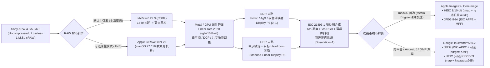

# 索尼 ARW 批量转换 Apple HDR（ISO/IEC 21496-1）软件前期技术调研报告

> **调研基准日期**：2026 年 11 月  
> **实测验证环境**：Apple Silicon Mac / **macOS 27.2**（Build `26B123`）、**Swift 6.4.2**、macOS 27.2 SDK（`ImageIO` / `CoreImage` / `CoreGraphics`）、Homebrew `libheif 1.21.2`（稳定版 `1.23.7`）、`libultrahdr 1.4.0`（稳定版 `2.0.2`）、`libavif 1.4.1`（稳定版 `1.4.2`）、`libraw`（稳定版 `0.22.3`）、`exiftool 13.55`。

---

## 1. 核心调研结论摘要（Executive Summary）

1. **为什么必须放弃索尼 HLG 直出，改走 ARW → ISO 21496-1 Gain Map 路线**：
   - 索尼相机直出的 HLG `.HIF` 是单流静态 10-bit BT.2020 HLG（`nclx` 9/18/9），**没有 SDR 基础图与 Gain Map**，且 HLG 将漫反射白定在 75% 信号位并依赖显示端 OOTF。在 iOS 非严格 HLG 管线（如快速预览、社交软件、部分相册缩略图/分享链路）下会丢失 OOTF/EDR 扩展导致**画面发灰发平**，或在强制 SDR 映射时高光断层。
   - **ISO/IEC 21496-1:2025（Apple 自适应 HDR / Adaptive HDR）** 已在 2025 年 7 月正式定稿，是 **iOS 18 / iOS 26 / iOS 27、macOS 15–27、Android 15–17 Ultra HDR、Adobe Camera Raw/Lightroom 与现代浏览器** 的共同主力标准：一套文件同时封装“高质量 SDR 基础图（8/10-bit Display P3 或 sRGB）+ 8-bit 对数增益图 + 归一化元数据”，在 SDR 端呈现创作者精确调校的 SDR 画面，在 iPhone XDR 屏幕上随屏幕峰值亮度平滑激发 HDR，真正实现 **SDR/HDR 双端观感可控**。
2. **双链路编码的核心实测发现（macOS 27.2 实测）**：
   - **Apple 原生链路（ImageIO + CoreImage）** 不仅能一键通过 Apple Silicon **Media Engine 硬件加速** 输出 **8-bit / 10-bit HEIC（`tmap`）与 8-bit JPEG（APP2 `urn:iso:std:iso:ts:21496:-1` + MPF）**，而且通过 `CIContext`（`.hdrImage`）或底层 `CGImageDestinationAddAuxiliaryDataInfo`（`kCGImageAuxiliaryDataTypeISOGainMap` + `HDRToneMap` XMP）均可**完全掌控自定义 SDR 基础图 + 自定义 HDR/增益图（含 1 通道亮度图与 3 通道 RGB 增益图）**，并可选择双写旧版 Apple `HDRGainMap` 兼容 iOS 14–17。
   - **开源跨平台链路关键事实**：上游原版 `strukturag/libheif`（实测至 `1.21.2` 头文件及 `1.22` 发布版）中 ISO 21496-1 `tmap`（PR #1503）仍处实验/未合入默认构建状态；若需 Windows/Linux 跨平台输出 HEIC+JPEG 双格式，或需要在 JPEG 中同时双写 **ISO 21496-1 APP2 + 旧版 Ultra HDR `hdrgm:` XMP**（兼容 Android 14），**Google `libultrahdr` v2.0.2** 已升级为多格式统一库（`JpegR` + `HeifUltraHdr` + `AvifUltraHdr`，内置 PR #1503 补丁），是跨平台首选。
3. **索尼 ARW 解码关键事实**：
   - 索尼现代机身（A7 IV / A7R V / A7C II / A9 III / A1 II / A7 V）存在 **ARW 4.0 / 5.0 / 6.0** 及 **无损压缩 M/S（实为去马赛克后的 YCbCr 伪 RAW）** 与 **ARW 6.0 Compressed HQ** 等变体。
   - 本机实测 macOS 27.2 `CIRAWFilter` 已覆盖 **115 款索尼机身**（含 A1 II、A9 III、A7 V、A7R V），其中 **18 款支持 iOS 27 / macOS 27 全新 `CIRAWDecoderVersion9`（ANE 神经网络去马赛克+降噪）**；但 Apple RAW 仍存在 M/S 压缩模式限制与黑盒色调曲线问题。推荐采用 **LibRaw 0.22.3（CDDL 许可，完整支持索尼 YCC M/S 与 14-bit 线性直出）为主引擎 + Apple `CIRAWFilter` v9 为可选原生引擎** 的双解码架构。
4. **推荐技术栈**：
   - 若面向 **macOS 创作者 + iPhone iOS 27 观看**（最贴合当前开发机与目标场景）：强烈推荐 **分阶段 Apple 原生模块化架构（架构 C1）**——**Phase 0** 用 Python 验证色彩与增益图数学，**Phase 1** 用 **Swift 6 + Metal + ImageIO + 内嵌 LibRaw 0.22（CDDL）** 构建无头核心库 `HDRPhotoCore` 与批量 CLI，**Phase 2** 套壳 **SwiftUI + 原生 `CAMetalLayer` 120Hz EDR 实时预览桌面端**（零 GPL 许可传染，天然支持 App Store 与 DMG 分发，享受 Apple Silicon 硬件编码 5–10× 加速）；若必须 Day-1 支持 Windows，则采用 C++/Rust DSP 核心 + 分平台编码/预览适配层（架构 C2），并规避 `x265` 与 `Exiv2` 的 GPL-2.0 许可风险。

---

## 2. 痛点根因：为什么索尼 HLG 直出 `.HIF` 在 iPhone 上不激发 HDR 甚至发灰？

索尼微单（α7 IV、α7R V、α6700、α1、FX30 等）开启 **HEIF + HLG 静止影像** 后输出扩展名为 `.HIF` 的 10-bit 4:2:0 或 4:2:2 HEVC 静态图。在 iPhone / iOS 生态下出现“发灰、对比度低、不触发 HDR 或高光断层”由四个底层原因叠加导致：

1. **单流静态编码，完全缺失 SDR 基础图与 Gain Map**：
   - 索尼 `.HIF` 容器中仅存单一 BT.2020 HLG 码流，不含任何 ISO 21496-1 `tmap` 或 Apple `urn:com:apple:photo:2020:aux:hdrgainmap` 增益图。
   - 一旦离开端到端 HLG 管线（如 iOS 文件/快速查看 SDR 缩略图、Sony Creators' App 预览、iCloud/分享面板重编码、微信/小红书/WhatsApp 等社交平台），接收端往往丢弃或忽略 HLG 传递特性，直接将对数感很强的 HLG 码值按 sRGB/Gamma 2.2 显示，立刻呈现**发灰、发闷、低饱和**。
2. **HLG 的 75% 漫反射白定义与 OOTF 缺失**：
   - 依据 ITU-R BT.2100 / ARIB STD-B67，HLG 将 **漫反射白（Diffuse White）锚定在约 75% 信号电平**（1000 nit 参考监视器下对应约 203 nit），将 75%–100% 留给镜面高光，并依赖显示端施加 **OOTF（光电传递函数，系统 Gamma ≈ 1.2）** 恢复正常反差。
   - 未正确执行 OOTF + EDR 提亮时，画面纯白实际只落在 75% 灰位；而 iOS 相册对无增益图的静态 HLG 做自动 SDR 映射时，又常在缺乏广播级映射曲线（如 ITU-R BT.2446）的情况下出现天空硬裁切或偏色（部分用户甚至需在 iOS 相册点“编辑”微调一下才能触发重渲染）。
3. **容器 `nclx` 信号、HEVC VUI 与 4:2:2 兼容性瑕疵**：
   - 索尼在 ISOBMFF `colr` box 中写入 `nclx`（Primaries=`9` BT.2020，Transfer=`18` ARIB STD-B67/HLG，Matrix=`9` BT.2020 NCL，Full Range=`1`）。历史固件（如 α7 IV / α7C II / α6700）曾出现容器 `nclx` 与 HEVC 码流 VUI `VideoFullRangeFlag` 不一致的问题；同时大量三方应用只读 ICC（`prof`/`rICC`）而不解析 `nclx`，或对 HEVC Main 4:2:2 10 支持不良。
4. **机身设置陷阱（`RAW + HEIF` 静默回退 SDR）**：
   - 多款索尼机身在同时开启 `RAW + HEIF` 时会静默将 HEIF 降级为 SDR 而非真正的 HLG；且即便单独拍 HLG `.HIF`，也会永久丧失 14-bit ARW 的宽容度与后期白平衡/色调控制空间。

---

## 3. iOS 26 / iOS 27 HDR 标准与 ISO/IEC 21496-1 深度规范

### 3.1 Apple OS 版本演进（WWDC 2024–2026）与 HDR 静态图更新

- **iOS 18 / macOS 15 Sequoia（2024）**：正式确立基于 **ISO/IEC 21496-1** 的 **Adaptive HDR（自适应 HDR）**，在 ImageIO/CoreImage 引入 `kCGImageAuxiliaryDataTypeISOGainMap`、`kCGImageDestinationEncodeToISOGainmap`、`CIImageRepresentationOption.hdrImage`、`.hdrGainMapAsRGB` 及 HEIC `tmap` 衍生项。
- **iOS 26 / macOS 26（2025）**：Apple 将全平台版本号统一切换为年份制（18 → 26）。新增**系统级 HDR 截屏**（默认输出内嵌 ISO 21496-1 Gain Map 的 HEIC）、**Safari 26** 全面增强 Web HDR（ISO 21496-1 JPEG/AVIF + W3C PNG 第三版 `cICP`），并在 CoreImage/CoreGraphics 新增 `imageBySettingContentHeadroom:`、`calculateHDRStats`、`CGImageCreateCopyWithCalculatedHDRStats` 等 API。
- **iOS 27 / macOS 27（2026）**：沿用 ISO/IEC 21496-1 作为主力静态 HDR 标准（无破坏性容器变更）；WWDC 2026 Session 305 推出 **Core Image RAW 9（`CIRAWDecoderVersion9`）**，通过 ANE 神经网络分块同时完成去马赛克与降噪，并在 ImageIO 新增 `kCGImageSourcePrioritizeQuality`。

### 3.2 iOS 27 支持的 HDR 静态图标准横评

| 格式标准 | 编码与信号特征 | iOS 27 相册 EDR 表现 | Safari / Web 支持 | SDR 回退与双端可控性 | 推荐定位 |
| :--- | :--- | :--- | :--- | :--- | :--- |
| **ISO/IEC 21496-1 Gain Map（HEIC / JPEG / AVIF）** | 8/10-bit SDR 基础图（Display P3/sRGB）+ 8-bit 1ch/3ch 增益图 + ISO 元数据 | **一等公民**：平滑按屏幕 EDR Headroom 线性/对数插值激发 | **原生支持**（HEIC/JPEG/AVIF；Chrome 支持 JPEG/AVIF） | **最佳**：SDR 端原样显示独立调校的基础图，绝不发灰 | **核心输出标准（HEIC + JPEG 双链路）** |
| **旧版 Apple HDR Gain Map（HEIC / JPEG）** | `auxC` `urn:com:apple:photo:2020:aux:hdrgainmap`（8-bit 单通道 Rec.709）+ MakerNote 33/48 | **原生支持**（iOS 14.1+） | 仅 Apple 生态 | 优秀，但不支持 3 通道 RGB 增益图，跨平台生态弱 | 可通过 ImageIO 作为**可选双写兼容层**照顾 iOS 14–17 |
| **10-bit PQ（HEIC / AVIF / PNG `cICP`）** | 单流 ST 2084（Transfer=`16`，BT.2020/P3），漫反射白锚定 203 nits | 支持 EDR | 支持 AVIF 与 PNG `cICP` | **较差**：无独立 SDR 版本，自动映射常偏暗或高光失控 | 不推荐面向普通相册/社交分发 |
| **10-bit HLG（`.HIF` / HEIF / PNG `cICP`）** | 单流 ARIB STD-B67（Transfer=`18`，BT.2020） | 触发不稳定/映射不一致 | 依赖容器与严格 HLG 管线 | **差**：极易发灰发平（即索尼直出痛点） | 仅作相机中间素材，不作为交付标准 |
| **Apple ProRAW / Camera RAW / OpenEXR** | 12–16-bit RAW 或 16/32-bit 浮点线性 | RAW 支持 EDR；EXR 非消费相册格式 | 不支持 | 文件极大（50–150 MB+） | 仅作专业母版/中间交换 |

### 3.3 ISO/IEC 21496-1:2025 数学模型与核心元数据

ISO/IEC 21496-1:2025（2025 年 7 月正式发布）统一了 Apple Adaptive HDR、Google Ultra HDR 与 Adobe Gain Map。所有连续参数均在线性光域（Linear Light，漫反射白 = `1.0`）下定义，二进制中以大端 32-bit 有理数（`numerator / denominator`）存储：

- **编码阶段**（已知同色域线性 SDR 基础图 $I_{\text{base}}$ 与线性 HDR 目标图 $I_{\text{alt}}$，通道 $c \in \{Y\}$ 或 $\{R,G,B\}$）：
  $$G_c = \log_2\!\left(\frac{\max(I_{\text{alt},c},\, 0) + k_{\text{alt},c}}{\max(I_{\text{base},c},\, 0) + k_{\text{base},c}}\right)$$
  $$M_{\text{lin},c} = \operatorname{clamp}\!\left(\frac{G_c - g_{\min,c}}{g_{\max,c} - g_{\min,c}},\; 0,\; 1\right), \qquad M_{\text{enc},c} = \left(M_{\text{lin},c}\right)^{\gamma_c}$$

- **解码阶段**（已知归一化增益图像素 $M_{\text{enc},c} \in [0, 1]$ 与当前屏幕线性可用 Headroom $H_{\text{display}} \ge 1.0$）：
  $$W = \operatorname{clamp}\!\left(\frac{\log_2(H_{\text{display}}) - H_{\text{base}}}{H_{\text{alt}} - H_{\text{base}}},\; 0,\; 1\right)$$
  $$G_c = g_{\min,c} + (g_{\max,c} - g_{\min,c}) \cdot \left(M_{\text{enc},c}\right)^{\frac{1}{\gamma_c}}$$
  $$I_{\text{out},c} = \left(I_{\text{base},c} + k_{\text{base},c}\right) \cdot 2^{\,W \cdot G_c} - k_{\text{alt},c}$$

> [!IMPORTANT]
> **两个极易写反的工程单位陷阱（已结合 `avif.h`、`libultrahdr` 与 Apple SDK 交叉验证）**：
> 1. **Headroom 单位差异**：在 ISO 21496-1 二进制元数据与 Apple `HDRToneMap` XMP 中，`base_hdr_headroom`（$H_{\text{base}}$）和 `alternate_hdr_headroom`（$H_{\text{alt}}$）以 **$\log_2$ 档位（stops）** 存储（例如 SDR 为 `0.0`，4× HDR 为 `2.0`，8× HDR 为 `3.0`）；而在 `CIImage.contentHeadroom` 与 `NSScreen.maximumExtendedDynamicRangeColorComponentValue` 中则是 **线性倍数**（SDR 为 `1.0`，+2 EV 为 `4.0`，+3 EV 为 `8.0`）。传递参数时务必显式转换！
> 2. **Gamma 幂次方向**：编码端是 $M_{\text{enc}} = M_{\text{lin}}^{\gamma}$，解码端是 $M_{\text{lin}} = M_{\text{enc}}^{1/\gamma}$。因此 $\gamma = 1.0$ 为均匀对数量化，$\gamma < 1.0$ 将更多 8-bit 码级分配给低增益过渡区，$\gamma > 1.0$ 偏向高增益极亮区。

### 3.4 HEIC 与 JPEG 容器封装结构对比

| 容器维度 | **HEIC（ISO/IEC 23008-12 Amd.1 `tmap`）** | **JPEG（ISO 21496-1 APP2 + MPF + 可选 XMP）** |
| :--- | :--- | :--- |
| **基础图编码** | **8-bit（Main）或 10-bit（Main10）HEVC**，推荐 Display P3 | **8-bit Baseline JPEG**，嵌入 Display P3 或 sRGB ICC Profile |
| **增益图存储** | 独立 HEVC 图像项（8-bit 1ch 灰度或 3ch 4:2:0），支持全尺寸或 1/2 缩放 | 追加在主图 `EOI` 之后的第二段完整 JPEG 码流（8-bit 灰度或 RGB/YCbCr） |
| **关联索引结构** | `ftyp` 含 `tmap`/`MiHB` 兼容品牌；`iinf` 声明衍生项 `'tmap'`；`iref` (`dimg`) 指向 `[base_id, gainmap_id]`；`grpl` (`altr`) 声明主图与 `tmap` 互斥备选 | 主图 `APP2` 携带 **MPF（CIPA DC-007）** 目录指明次图字节偏移与长度 |
| **ISO 21496-1 元数据位置** | 存于 `'tmap'` 衍生项载荷（1 字节版本前缀 `0x00` + ISO 21496-1 二进制结构），通过 `iprp`/`colr` 指定备选色域 | 主图 `APP2` 含 28 字节 URN **`urn:iso:std:iso:ts:21496:-1\0`** + 4 字节版本头；次图 `APP2` 含同 URN + 完整 ISO 21496-1 二进制元数据 |
| **旧生态双写兼容** | 可额外附加 `auxC` `urn:com:apple:photo:2020:aux:hdrgainmap` 兼容 iOS 14–17 | 可额外在主图写 `GContainer:Directory` XMP、次图写 `hdrgm:` XMP（兼容 Android 14 / 旧版 Adobe，**仅限单通道增益图**） |

### 3.5 2026 跨平台互通矩阵

| 平台 / 应用 | ISO 21496-1 **HEIC (`tmap`)** | ISO 21496-1 **JPEG (APP2 + MPF)** | 工程落地说明 |
| :--- | :---: | :---: | :--- |
| **iOS 18 / 26 / 27 相册与快速查看** | **完整 EDR（原生首选）** | **完整 EDR** | HEIC 10-bit Display P3 体积更小且暗部无断层 |
| **macOS 15 / 26 / 27 相册与预览** | **完整 EDR** | **完整 EDR** | 均由 ImageIO/CoreImage 原生解码 |
| **Android 15 / 16 / 17（Ultra HDR）** | **Android 16+ 支持** (`HEIC_ULTRAHDR`) | **全系完整 HDR** | 兼容 Android 14 需在 JPEG 双写 `hdrgm:` XMP |
| **Safari（iOS/macOS 26–27）** | **完整 EDR** | **完整 EDR** | Safari 26 亦支持 HDR AVIF 与 PNG `cICP` |
| **Chrome / Edge（桌面与 Android）** | 不支持 HEIC 解码 | **完整 HDR**（Skia `SkGainmapInfo`） | Web 跨浏览器分享优先使用 ISO JPEG（或 AVIF） |
| **Adobe Lightroom / Camera Raw** | 支持读取 | **原生读写** | 完美保留双端结构 |
| **微信 / 小红书 / Instagram** | iOS 原图上传链路支持度高 | 支持度持续提升（原图链路） | 非原图二次压缩会剥离增益图，此时会安全回退到精调的 SDR 基础图 |

---

## 4. 索尼 ARW 解码、色彩科学与“SDR/HDR 双端可控”算法管线

### 4.1 索尼 ARW 格式变体与解码后端实测评估

索尼现代 Alpha 机身已演进至 **ARW 4.0 / 5.0 / 6.0**，并非所有 `.ARW` 都是标准 14-bit Bayer 马赛克：

| 索尼 RAW 压缩模式 | 常见机身 / 版本 | 位深与底层编码 | 解码器关键陷阱 |
| :--- | :--- | :--- | :--- |
| **未压缩（Uncompressed）** | A1 / A7IV / A7RV / A9III（ARW 6.0 A7V 起移除） | 14-bit 真 Bayer | 体积最大，解码最快 |
| **无损压缩 L（Lossless L）** | A7IV / A7RV / A7CII / A6700 / A9III / A1II / A7V | 14-bit 真 Bayer（分块 LJ92） | **推荐拍摄模式**，无画质损失且省空间 40–50% |
| **无损压缩 M / S（Lossless M/S）** | A7IV / A7RV / A7CII / A9III / A1 / A1II | **非 Bayer！机内已去马赛克并应用白平衡的 YCbCr 伪 RAW** | **重灾区**：RawSpeed/Darktable/DxO 不支持；旧版 Apple RAW 易偏品红或打不开；**LibRaw 0.22+ 已完整支持** |
| **有损压缩（cRAW）** | 全系 | 单拍 14-bit，连拍/电子快门常降为 12-bit | 暗部强拉 >4 EV 时偶见条纹/色带 |
| **有损压缩 HQ（Compressed HQ）** | A7 V（ARW 6.0） | 14-bit 新型压缩 | 第三方与 OS 更新存在滞后 |

> **本机 macOS 27.2 `CIRAWFilter` 实测数据**：
> - `CIRAWFilter.supportedCameraModels` 共支持 **115 款索尼机身**，已涵盖 `ILCE-1`、`ILCE-1M2`（A1 II）、`ILCE-9 III`（A9 III）、`ILCE-7M4`（A7 IV）、`ILCE-7M5`（A7 V）、`ILCE-7R V`（A7R V）、`ILCE-7C II`、`ILCE-6700`、`ZV-E1`、`ILME-FX3/FX30`、`DSC-RX1R III` 等最新机型。
> - 其中 **18 款机型**（含 A6700、A7C II、A7 IV、A7R V、A7S III、RX1R III 等）支持 macOS 27 / iOS 27 新增的 **`CIRAWDecoderVersion9`**（ANE 神经网络去马赛克与降噪）。
> - **但 Apple RAW 的局限**：① 对索尼无损压缩 M/S 的按模式支持并不透明且随系统升级存在兼容波动；② 默认施加黑盒 S 曲线与局部色调映射（需关闭 `boostAmount=0`、`localToneMapAmount=0` 才近似线性），且跨 macOS 版本画质可能变化。

**解码架构建议**：以 **LibRaw 0.22.3（选择 CDDL-1.0 许可，避免 GPL）** 作为**确定性默认主引擎**（覆盖全系无损 L/M/S、可控 14-bit 线性输出、高光重构完全透明），同时在 macOS 端提供 **Apple `CIRAWFilter` v9（`extendedDynamicRangeAmount`）** 作为可选“Apple 神经网络降噪/原厂色彩模式”。

### 4.2 传感器动态范围、线性空间与高光重构

- **索尼传感器宽容度与线性 Headroom 映射**：
  - A7R V（~14.8 EV）、A7 IV（~14.7 EV）、A1（~14.5 EV）在 ISO 100 具备极佳单帧 HDR 潜力；**A9 III 全局快门**（Base ISO 250，峰 PDR ~10.2 EV）暗部底噪上升更快，需减少暗部提亮并调稳 Gain Map `offset`。
  - 线性空间中 18% 中灰 = `0.18`，SDR 漫反射白 = `1.0`（中灰以上 +2.47 EV）。当摄影师采用向右曝光/欠曝保高光（-1~-2 EV 测光）拍摄天空、逆光或夜景灯光时，经曝光归正后的线性传感器高光可稳定延伸至 **漫反射白之上 +2.0 ~ +4.0 EV（线性值 `4.0` ~ `16.0`）**，恰好匹配 iPhone XDR 的 HDR 激发区间。
- **高光重构与“洋红高光”防踩坑**：
  - 白平衡增益通常令 $R_{\text{mul}} \approx 2.5, G_{\text{mul}} = 1.0, B_{\text{mul}} \approx 1.6$，导致饱和像素在未处理时呈品红色。
  - **绝不能使用 LibRaw `-H 0`（硬裁切至 1.0）**，那会直接抹平所有 HDR 高光余量！生产管线应提取未裁切归一化 Bayer 数据（`-H 1` 或自定义 `unpack()`），在去马赛克阶段配合现代高光重构算法（参考 darktable **`inpaint opposed`** 或 LibRaw `-H 2` Blend / `-H 5` Rebuild），保留超过 `1.0` 的真实高光亮度梯度。
- **工作色彩空间与 DCP/索尼风格**：
  - 推荐以 **Linear Rec.2020 (D65) `f32`/`rgba16Float`** 作为主调色空间（完整包裹 Display P3，避免矩阵变换产生负值截断），通过 DNG/DCP 双光源插值 `ForwardMatrix`（或 `ColorMatrix` + Bradford D50→D65 色适应）映射，在输出前软映射至 **Extended Linear Display P3**。
  - 若加载 Adobe Camera Matching DCP（模拟索尼 ST/NT/VV/FL/IN Creative Look），**必须跳过或高光外推 `[0, 1]` 范围的 `ProfileToneCurve`**（保留场景参考的 `HueSatDeltas` 与 `LookTable`）；若支持用户自定义 `.cube` 3D LUT，必须以可逆 **Log Shaper**（如 S-Log3 / `log2` 映射 `[-10 EV, +6 EV] → [0, 1]`）包裹 LUT，避免硬切掉 `> 1.0` 的 HDR 高光。

### 4.3 “SDR/HDR 双端观感可控”核心算法设计

为了兼顾“SDR 端立体通透、不发灰”与“HDR 端高光通透立体、不出现人脸发光/过渡跳变”，采用 **“共享场景级调色 → 中灰锚定双支路映射 → 闭环 Gain Map 合成”** 架构：

1. **共享场景级调色（Linear Rec.2020）**：统一完成曝光 EV、白平衡、阴影/黑位恢复、清晰度与基础色彩风格，保证 SDR 与 HDR 的基调与色相一致。
2. **中灰锁定双支路高光映射（Midtone-Locked Dual-Branch Tone Mapping）**：
   - 在共享中灰/暗部曲线 $f_{\text{mid}}(x)$ 之下，设定肩部拐点 $P$（例如 $P \approx 0.75\text{–}0.85$ 线性，确保人像肤色与正常中灰锚定在 $\le 1.0$ 区域，不会在 iPhone 上变成“核辐射发光脸”）：
     - 当 $x \le P$ 时：**$f_{\text{hdr}}(x) = f_{\text{sdr}}(x) = f_{\text{mid}}(x)$**（暗部与中灰增益 $g \approx 0$，保证屏幕亮度变化或切换 HDR 时无反差跳变）。
     - 当 $x > P$（拐点斜率 $m = f'_{\text{mid}}(P)$）时，使用 $C^1$ 连续有理肩部曲线向渐近上限 $L_{\max}$ 滚降：
       $$f(x;\; P, m, L_{\max}) = P + \frac{(L_{\max} - P) \cdot m(x - P)}{(L_{\max} - P) + m(x - P)}$$
       - **SDR 支路**：令 $L_{\max} = 1.0$（或切换 **AgX / OpenDRT** 电影感色调映射），叠加可选的独立 **SDR 微调滑块**（SDR 高光压缩、SDR 对比度/饱和度补偿），在接近 `1.0` 时执行自然向白退饱和，杜绝数码死白。
       - **HDR 支路**：令 $L_{\max} = 2^{H_{\text{target}}}$（用户可调目标 Headroom，推荐默认 `+2.0 ~ +2.5 EV` 即 `4×–5.6×`，上限 `+4.0 EV` 即 `16×`），高光退饱和力度远轻于 SDR，保留霓虹灯、晚霞与蓝天的真实高光色彩。
3. **Gain Map 质量优化与防伪影工程铁律**：
   - **1 通道亮度图 vs 3 通道 RGB 增益图**：
     - 当 SDR 支路为了保高光层次而对亮色（霓虹、日落、蓝天）做退饱和处理时，**单通道增益图**只能按比例拉亮已经发白的像素，导致 HDR 端依然惨白；**3 通道 RGB 增益图** 可无损还原高饱和彩色高光，建议作为专业默认项（单通道作为“极致体积/兼容 Android 14 XMP”档位）。
   - **防 8-bit 增益图色带（Banding）**：量化前加入 **TPDF / 蓝噪声抖动（Dithering）**；按画面 0.01%–99.99% 分位数紧致设置 `gain_map_min`/`gain_map_max`（避免单个热噪点浪费码级）；设定对称偏移量 $k_{\text{base}} = k_{\text{alt}} = 1/64\ (0.015625)$ 并在中灰拐点以下软钳位 $g = 0$，防止暗部传感器噪点在比值运算中爆炸。
   - **防高光光晕（Halos）**：高对比剪影边缘（暗树枝对亮天空）经 1/4 缩放增益图双线性放大极易泛出亮边。建议默认使用 **1/2 分辨率（配线性域下采样或边缘引导滤波）或 1:1 全分辨率**（平缓 SDR 区域增益恒定为 0，HEVC/JPEG 压缩率极高）。
   - **闭环基础图补偿（Closed-Loop Base Compensation）**：针对 8-bit JPEG 输出，先对 SDR Base 做编解码还原出真实量化后的 $\hat{B}$，再计算 $\log_2((H+k)/(\hat{B}+k))$，可大幅抑制 8-bit 量化与 4:2:0 色度抽样误差在高增益下的块效应放大。
   - **色域防截断**：在 Rec.2020 → Display P3 转换时采用 OKLab / ACES 2.0 保持色相的软色域压缩（严禁简单 `max(rgb, 0)` 截断导致索尼深蓝变紫），并以 `use_base_colour_space = 1` 编码。

### 4.4 EXIF / MakerNote 安全迁移规范

| 风险项 | 成因 | 强制工程对策 |
| :--- | :--- | :--- |
| **JPEG APP1 64 KB 溢出** | 索尼 ARW 原生 `MakerNote` (`0x927C`) 常达 30–60+ KB，直接透传会撑爆 JPEG 65,535 字节 APP1 上限导致写入失败或静默截断 | **严禁透传原始索尼 MakerNote**；仅从 ARW 提取并重序列化标准 Exif 2.32 白名单（Make/Model、`LensModel` `0xA434` 及回退读取 Sony `LensSpec`、曝光三要素、焦距、`DateTimeOriginal` + **`OffsetTimeOriginal` `0x9010`**、完整 GPS），体积控制在 4–8 KB 内 |
| **Orientation 不一致导致增益图错位重影** | ISO 21496-1 与 `libultrahdr` 均要求主图与增益图像素方向严格一致，解码器常忽略次图旋转标签 | **编码前将主图与增益图物理旋转为正向**，并在输出 EXIF 中强制写入 **`Orientation = 1`** |
| **事后修改元数据破坏 HDR 容器** | 暴力调用外部工具覆写 EXIF 会错乱 JPEG MPF 字节偏移或破坏 HEIC `meta`/`infe`/`tmap` 链接 | **仅在编码期注入 EXIF**（ImageIO Properties / `libultrahdr` `uhdr_enc_set_exif_data` / `libheif` `heif_context_add_exif_metadata`）；若必须事后校验/编辑，强制使用 **ExifTool ≥ 13.09** |

---

## 5. ARW → HEIC / JPEG 双链路编码实现方案

### 5.1 端到端双链路架构图

### 5.2 链路 A：Apple 原生 API（macOS 15–27 实测验证，macOS 平台绝对首选）

通过读取本机 macOS 27.2 SDK 头文件并进行内存态运行实测，Apple 原生框架在 **HEIC（8-bit 与 10-bit）** 和 **JPEG（8-bit）** 上均已完备支持 ISO 21496-1，且 HEIC 自动走 Apple Silicon **Media Engine（VideoToolbox）硬件编码**（速度比 CPU `x265` 快 **5×–10×**）。

> [!WARNING]
> **本机 macOS 27.2 SDK 实测避坑清单**：
> 1. **官方常量大小写陷阱**：`kCGImageDestinationEncodeToISOGainmap` 的 `m` 是**小写**，而 `kCGImageAuxiliaryDataTypeISOGainMap` 的 `M` 是**大写**。
> 2. **macOS 26 新增但未文档化的 ImageIO 编码子键勿盲用**：SDK 头文件中虽存在 `kCGImageDestinationEncodeGenerateGainMapWithBaseImage`、`kCGImageDestinationEncodeGainMapSubsampleFactor` 等（标注起始版本 16/19 即 macOS 26/iOS 26），但本机 macOS 27.2 实测传入 `CGImageRef` 会导致 `finalize` 失败，传入缩放因子会被静默忽略。生产环境请采用下方已实测通过的 **A1** 或 **A2** 方案。
> 3. **RGB 增益图回读格式**：使用 `CGImageSourceCopyAuxiliaryDataInfoAtIndex` 读取 3 通道 RGB ISO 增益图时，macOS 返回的是 `420f`（全范围双平面 YCbCr 4:2:0）而非 RGBA8；读取时优先用 `CIImage(contentsOf:options: [.auxiliaryHDRGainMap: true])`。

#### 方案 A1：CoreImage `CIContext` 双图直出（代码最简）
将独立调校好的 SDR `CIImage` 作为主图，将已通过 `.settingContentHeadroom(linearHeadroom)` 标定峰值倍数的 HDR `CIImage` 传入 `options: [.hdrImage: hdrCIImage, .hdrGainMapAsRGB: true/false]`：
- `writeHEIFRepresentation`（`.RGBA8`, Display P3）→ **8-bit HEIC + 1× 全尺寸 8-bit ISO `tmap` 增益图**
- `writeHEIF10Representation`（Display P3）→ **10-bit HEIC（`Depth=10`）+ 1× 全尺寸 8-bit ISO `tmap` 增益图**
- `writeJPEGRepresentation`（Display P3）→ **8-bit JPEG + 1× 全尺寸 8-bit ISO APP2 + MPF 增益图**
- *局限*：始终输出 1× 全尺寸增益图，且不写入旧版 Apple `HDRGainMap`。

#### 方案 A2：ImageIO `CGImageDestinationAddAuxiliaryDataInfo`（完全参数可控，**强烈推荐用于生产引擎**）
由自研 Metal Compute Shader 精确计算增益图（自由选择 **0.5× 或 1× 分辨率**、**1 通道 `'L008'`** 或 **3 通道 `'BGRA'`**、蓝噪声抖动及紧致 `min`/`max`/`gamma`/`offset`），随后：
1. 调用 `CGImageDestinationAddImage` 写入自定义 SDR `CGImage`（传 **8-bit Display P3** 得 8-bit HEIC/JPEG；传 **16-bit Display P3** 时 ImageIO **自动硬件编码为 10-bit HEIC `Depth=10`**！）并附带洁净 EXIF 字典。
2. 调用 `CGImageDestinationAddAuxiliaryDataInfo(dest, kCGImageAuxiliaryDataTypeISOGainMap, auxDict)`，其中 `kCGImageAuxiliaryDataInfoMetadata` 使用 Apple `HDRToneMap` XMP Schema（`xmlns:HDRToneMap="http://ns.apple.com/HDRToneMap/1.0/"`，含 `BaseHeadroom`、`AlternateHeadroom`、`ChannelMetadata` 序列、`BaseColorIsWorkingColor`）。ImageIO 会自动将其编译为标准 **HEIC `tmap`** 或 **JPEG APP2 `urn:iso:std:iso:ts:21496:-1` + MPF**。
3. **可选旧版 iOS 14–17 兼容双写**：在同一次 `CGImageDestination` 中紧接着再调用一次 `CGImageDestinationAddAuxiliaryDataInfo(dest, kCGImageAuxiliaryDataTypeHDRGainMap, legacyAuxDict)`（实测在 macOS 27.2 上可同时生成 `tmap` + `urn:com:apple:photo:2020:aux:hdrgainmap`）。
4. *唯一边界*：Apple ImageIO **不会**向 JPEG 写入旧版 Google/Adobe `hdrgm:` XMP（仅写 ISO 21496-1 APP2）。若产品需要同时照顾 Android 14 旧机的 JPEG HDR，可在 JPEG 链路切换到 `libultrahdr` 或向 MPF 次图补写 `hdrgm:` XMP。

### 5.3 链路 B：跨平台开源编码库（Windows / Linux / Android 14 双写补强）

| 组件 | 2026 年底最新状态 | 关键能力与已知坑点 |
| :--- | :--- | :--- |
| **`google/libultrahdr`** | **v2.0.2**（稳定版，Apache-2.0） | **跨平台一站式首选**：v2.0 重构为 `JpegR` + `HeifUltraHdr` + `AvifUltraHdr` 统一接口，开启 `-DUHDR_ENABLE_HEIF=ON -DUHDR_BUILD_DEPS=ON` 后自动拉取并打上 `libheif` PR #1503 `tmap` 补丁，**一个库搞定 JPEG + HEIC + AVIF 三种 ISO 21496-1 输出**！支持 **API-1**（传自定义 Raw HDR + Raw SDR）与 **API-4**（传预压缩 SDR + 自定义增益图 + `uhdr_gainmap_metadata_t`）。 **注意事项**：① 开启 `-DUHDR_WRITE_ISO=ON -DUHDR_WRITE_XMP=ON` 可同时双写 ISO APP2 与 `hdrgm:` XMP（兼容 Android 14），但 **`hdrgm:` XMP 仅支持单通道增益图**，启用 3 通道 RGB 时应关闭 `UHDR_WRITE_XMP`；② 务必使用 v1.5.1+/v2.0.x（修复了旧版 Display P3 色域系数误差与 ICC 溢出 Bug），并设置 `UHDR_CG_DISPLAY_P3` 与 `use_base_cg = 1`。 |
| **`strukturag/libheif`** | v1.22.0 / Homebrew `1.23.7`（LGPL-3.0） | 实测本机 `1.21.2` 头文件未暴露任何 `tmap` 公开 API；上游 PR #1503（`-DWITH_EXPERIMENTAL_GAIN_MAP=1`）仍为实验特性，暂不宜直接裸接原版 `libheif` 做 `tmap` 写入。默认后端 `x265` 为 **GPL-2.0** 且 CPU 编码慢；商业/闭源跨平台构建若使用 `libheif` 需切换为 **BSD-3 许可的 `kvazaar`**（支持 8/10-bit HEVC）或平台硬件编码器（Windows Media Foundation / NVENC）。 |
| **`libavif`** | v1.4.2（BSD-2） | 上游原生生产级 `avifGainMap`（`tmap`）实现非常成熟（本机头文件已验证），未来如需扩展 Web HDR AVIF 导出可无缝接入。 |

### 5.4 自动化合规验收与排查工具链

开发阶段建议在 CI 和批量导出流程中内置自动验收探针：
1. **Apple 原生解码探针（黄金标准）**：轻量 Swift 校验脚本，对导出文件调用 `CGImageSourceCopyAuxiliaryDataInfoAtIndex(src, 0, kCGImageAuxiliaryDataTypeISOGainMap)` 确认非空，并以 `kCGImageSourceDecodeToHDR` 解码确认 `CGImageGetContentHeadroom(img) > 1.0`。
2. **JPEG 字节级验真**：`exiftool -G1 -a -s -ee out.jpg` 检查 `[APP2] UniformResourceName : urn:iso:std:iso:ts:21496:-1`、`[MPF] MPImageType : Gain Map Image`、`[ICC_Profile] Display P3` 及 `Orientation : Horizontal (normal)`；配合 `ultrahdr_app -P out.jpg` 无损探测结构完整性。
3. **HEIC 盒结构验真**：`MP4Box -info out.heic` / `MP4Box -diso out.heic` 与 `heif-info out.heic` 检查 `ftyp`（`heic`/`mif1`/`tmap`）、`iinf`（`tmap`）、`iref`（`dimg`）、`grpl`（`altr`）以及主图位深（8/10-bit）。
4. **视觉与真机验收**：Adobe **Gain Map Demo App**（交互式拖动 1×–8× Headroom 检查过渡平滑度），并经 AirDrop / iCloud 传至 iOS 27 真机相册确认 EDR 激发、缩略图一致性与分享回退观感。

---

## 6. 竞品生态空白、技术栈选型与工程架构

### 6.1 现有工具痛点定位（为什么值得做这款软件）

- **Adobe Lightroom / ACR**：支持 ISO 21496-1 JPEG/AVIF/JXL，但**原生不支持直接导出 ISO 21496-1 HEIC**；订阅贵、目录导入重、SDR 覆写需逐张微调。
- **Photomator / Nitro Photo**：深度依赖 Apple RAW（新机身与索尼 M/S 支持滞后），无双格式批量 CLI，缺乏对 SDR 与 HDR 曲线的精细独立参数控制。
- **Capture One / DxO PhotoLab / Sony Imaging Edge**：虽然索尼色彩优秀，但至今**完全无法导出消费级 iPhone 自适应 HDR 增益图**。
- **Darktable / RawTherapee / 开源 CLI（`HDR2gainmap`、`hlg-to-sdr-hdr`、`toGainMapHDR`）**：前者需复杂两步脚本（先导出数百 MB 中间 TIFF 再调用外部脚本），后者仅接受已显影的 TIFF/EXR/HIF，**缺少一站式“索尼 ARW 直转 → 实时 EDR 调校 → 批量 HEIC + JPEG 双输出”工具**。

### 6.2 技术栈方案多维对比

| 评估维度 | **方案 A / C1：macOS 原生模块化**（Swift 6 + SwiftUI + Metal + ImageIO + 内嵌 LibRaw 0.22） | **方案 B：全栈跨平台**（Rust/C++ + `wgpu` + `libultrahdr` v2 / `libheif` + Tauri/Qt） | **方案 C2：跨平台核心 + 原生适配层**（C++/Rust DSP + macOS ImageIO/Metal + Win DX12/MF） | **方案 D：Python 原型**（`rawpy` + `numpy` + `pyobjc`/`libultrahdr`） |
| :--- | :---: | :---: | :---: | :---: |
| **开发效率** | **高**（单一主语言 + 极薄 LibRaw C++ 桥接） | 中低（跨端构建、WebView/Qt 适配复杂） | 低（FFI + 双端 UI/编码维护，初期工作量 2–2.5×） | **最快**（仅适合作算法 R&D） |
| **目标平台覆盖** | macOS（无缝复用至 iOS/iPadOS） | macOS + Windows + Linux | macOS + Windows（+ Linux CLI） | 研发脚本 |
| **原生 120Hz EDR 预览** | **最佳**（`CAMetalLayer` 零拷贝、无 FPS 节流） | 中（Tauri WKWebView 有帧率节流与 IPC 拷贝；Linux WebGPU 脆弱） | **优秀**（各平台原生 HDR 渲染） | 无 |
| **批量编码吞吐（Apple Silicon）** | **极快**（Media Engine 硬件 HEVC，快 5–10×） | 慢（默认 CPU `x265`，风扇满载） | **极快**（macOS 走 ImageIO，Win 走 NVENC/MF） | 极慢（61MP NumPy 内存暴涨） |
| **iOS 27 兼容性保障** | **100%**（直接调用 Apple 官方编码器） | 良好，但需重点真机回归 `libheif` `tmap` | macOS 100%，Win 需回归验证 | 经 `pyobjc` 高 |
| **开源许可与 App Store 风险** | **洁净**（LibRaw CDDL + Apple SDK，零 GPL） | **高风险**（`x265` + `Exiv2` 均为 **GPL-2.0**，传染闭源且禁止上架 App Store） | 规避 `x265`/`Exiv2` 后洁净 | 不适用 |

> [!CAUTION]
> **开源许可证雷区**：若未来计划闭源商业化或上架 Mac App Store，**绝对禁止链接 `x265`（GPL-2.0）或 `Exiv2`（GPL-2.0）**！LibRaw 拥有 **CDDL-1.0 / LGPL-2.1** 双许可（选 CDDL 即可静态/动态合规集成），EXIF 序列化在 macOS 端直接用 ImageIO、跨平台端用 permissive 库或轻量自研 Exif 2.32 写入器，跨平台 HEVC 编码可选用 **BSD-3 的 `kvazaar`** 或系统硬件编码 API。

### 6.3 推荐技术路线图（分阶段落地）

1. **Phase 0（算法验证原型，3–5 天）**：用 Python（`rawpy` + `numpy` + `pyobjc` 调本机 macOS ImageIO）快速跑通几张典型索尼 ARW（逆光人像、日落风景、高对比夜景霓虹），实测对比 1ch vs 3ch 增益图、AgX vs 有理肩部曲线、8-bit vs 10-bit HEIC 与 JPEG 在 iPhone iOS 27 真机上的实际激发效果，锁定数值黄金基准。
2. **Phase 1（核心引擎 + 高速批量 CLI，2–3 周）**：使用 **Swift 6 + Metal + ImageIO + 内嵌 LibRaw 0.22.3（CDDL）** 构建无 UI 依赖的 `HDRPhotoCore` Swift Package 与命令行工具 `hdrphoto-cli`，内置 JSON 预设系统、单次解码并发输出 HEIC + JPEG、EXIF 白名单迁移与自动 ISO 21496-1 合规探针。*(若需 JPEG 兼容 Android 14 XMP，可作为可选模块链接本机已有的 `libultrahdr` 2.0.2)*。
3. **Phase 2（macOS 桌面端 + 原生 EDR 实时预览，3–4 周）**：基于同一个 `HDRPhotoCore` 构建 SwiftUI + `CAMetalLayer` 原生桌面端，提供所见即所得的 XDR 实时预览、iPhone 亮度模拟滑块与批量任务队列管理。
4. **Phase 3（可选扩展）**：利用 `HDRPhotoCore` 快速衍生 iPadOS / iOS 伴侣 App（现场读卡直转入 iPhone 相册），或仅将核心纯数学 Metal Shader 移植为 WGSL + `libultrahdr` v2 扩展至 Windows。

---

## 7. 61MP 批量处理性能与 EDR 预览交互架构

### 7.1 内存预算与 3 阶段有界流水线（以索尼 A7R V 61MP 为例）

单张 A7R V（`9504 × 6336`）若采用 `RGBA32F` 朴素多线程并发，单帧峰值可达 **1.8–2.4 GB**，极易将 16 GB 内存 MacBook 撑爆。工程上必须遵守：
- **GPU 工作缓冲统一采用 `RGBA16F`（`rgba16Float`）**：单帧仅 **482 MB**（立省 50% 内存），10-bit 尾数 + 5-bit 指数覆盖 `0..65504`（超过漫反射白 +12 EV，精度误差 <0.1%），完全满足照片级 HDR。
- **`MTLHeap` 纹理池复用**：同机身批量 ARW 分辨率一致，预分配可复用 GPU 纹理池消除频繁分配抖动；每帧用 `autoreleasepool {}` 及时回收 CoreGraphics/ImageIO 临时对象。
- **3 阶段有界生产者-消费者流水线（严格背压）**：
  - **Stage 1（CPU 解码，2–3 Worker）**：LibRaw 解码/去马赛克（限制单 Worker 内部 OpenMP 线程防止争抢）+ 提取洁净 EXIF，输出至容量=2 的有界队列。
  - **Stage 2（GPU Metal 计算，深度=2 命令队列）**：矩阵转换 → 共享调色 → SDR/HDR 双支路 → 增益图计算与物理旋转烘焙，输出至容量=2 的有界队列。
  - **Stage 3（硬件编码与落盘，2 Worker）**：单次计算结果同时扇出至 Apple Media Engine HEIC 编码器与 JPEG 编码器，原子写盘并执行轻量合规校验。
  - **动态内存并发控制**：16 GB RAM 机器限制同时在途 61MP 帧数 ≤ 2；32 GB+ 机器放宽至 3–4 帧。

### 7.2 原生 EDR 实时预览与“SDR/HDR 双端可控”交互设计

- **所见即所得（WYSIWYG）ISO 21496-1 模拟预览**：
  - 交互调参时加载代理分辨率（LibRaw `half_size=1` 或 ~3MP GPU 纹理，约 25 MB），所有滑块调整在单个 Metal Fragment Shader 内 **60–120 fps（<2 ms）** 实时响应。
  - 预览 Shader 直接执行 **ISO 21496-1 真实解码公式**（含 8-bit 增益图量化效应），并配置 **目标屏幕 Headroom 模拟滑块**，一键切换真实 iPhone 观看档位：**`1.0×`（0 EV 纯 SDR 回退）** / **`2.0×`（+1 EV 户外强光）** / **`4.0×`（+2 EV 室内日常）** / **`8.0×`（+3 EV 暗室 XDR 峰值）**。若外接普通 SDR 显示器（$H_{\text{display}} = 1.0$），提供“曝光缩放预览”开关（画面整体乘以 $1/H_{\text{sim}}$）依然能检查高光滚降细节。
- **核心辅助检视工具**：
  - **同屏滑动分屏对比**：左半屏强制 $W = 0$（纯 SDR），右半屏实时激发 EDR，直观对比双端观感。
  - **Headroom 假彩色热力图**（标注 `+0~1 EV` / `+1~2 EV` / `+2~3+ EV` 及传感器硬裁切区）+ **双区直方图**（清晰标出 `0 EV` SDR 白点分界线与右侧 HDR 延伸区）+ 一键 **Gain Map 检视图**（`G` 键排查光晕与暗部噪点）。
- **分级可调参数与预设体系**：
  1. **RAW 与场景基调**：白平衡（拍摄值/色温色调）、基础曝光、索尼 DCP 色彩配置文件、暗部/黑位。
  2. **SDR 端独立控制**：SDR 映射曲线（AgX / 中性电影感 / ACES）、SDR 曝光微调、SDR 高光压缩肩部、SDR 对比度与饱和度。
  3. **HDR 端与增益图控制**：HDR Headroom 上限（默认 `+2.0~+2.5 EV`）、高光激发力度、中灰/肤色锚定点、增益图通道（1ch 亮度 / 3ch RGB）、增益图分辨率（1/2 / 1:1）。
  4. **双链路导出策略**：输出格式（仅 HEIC / 仅 JPEG / **HEIC + JPEG 双出**）、HEIC 位深（**10-bit 默认** / 8-bit）、基础色域（**Display P3 默认** / sRGB）、旧版兼容开关（iOS 14–17 Apple `HDRGainMap` 双写 / Android 14 `hdrgm:` XMP 双写）、压缩质量（0.85–0.92）。
  5. **批量 Preset + 单张覆写**：内置场景预设（如 *索尼人像 +1.8 EV*、*风光自然 +2.5 EV*、*夜景霓虹 RGB +3.0 EV*），允许整批套用预设的同时对个别过曝/偏色照片做增量覆写。

---

## 8. 关键参考来源
- **ISO/IEC 21496-1:2025**：*Digital photography — Gain map metadata for image conversion — Part 1: Dynamic range conversion*（2025 年 7 月正式发布）
- **Apple 官方 SDK 与 WWDC**：本机 macOS 27.2 SDK 头文件（`CGImageDestination.h`、`CGImageProperties.h`、`CIContext.h`、`CIImage.h`、`CIRAWFilter.h`、`CGImage.h`）；WWDC 2024 Session 10177（*Use HDR for dynamic image experiences in your app*）；WWDC 2026 Session 305（*Enhance RAW image processing with Core Image* / RAW 9）
- **核心开源库**：LibRaw `0.22.0–0.22.3`（`LibRaw/LibRaw`）、Google `libultrahdr` `v1.5.1–v2.0.2`（`google/libultrahdr`）、`strukturag/libheif`（`v1.21–1.23`，PR #1503 & Issue #1685）、`AOMediaCodec/libavif`（`v1.2–1.4`）、ExifTool `≥13.09`
- **生态与社区参考**：`vastunghia/HDR2gainmap`、`chemharuka/toGainMapHDR`、`dmitry907/hlg-to-sdr-hdr`、Adobe Gain Map Demo App、Photons to Photos 索尼传感器 PDR 数据库
