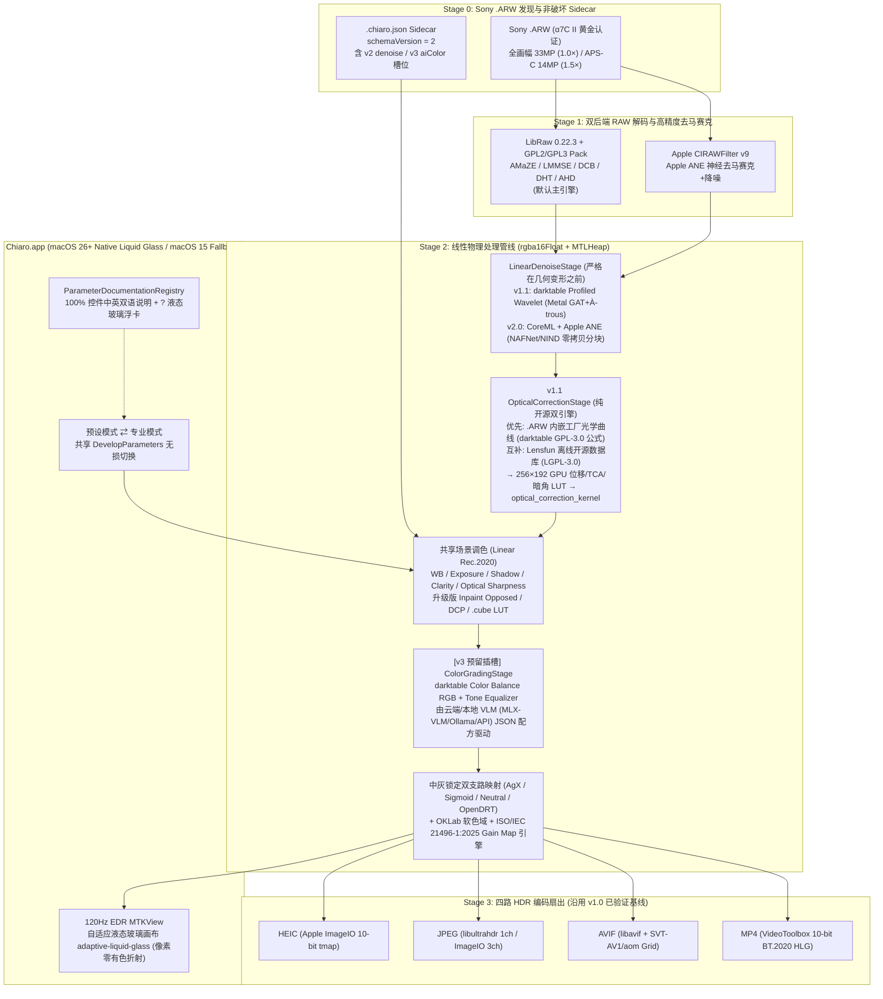

# 架构决策记录（ADR）：`Chiaro` v1.1 — Sony A7C2 光学暗房、液态玻璃体系与 v2/v3 AI 管线前瞻架构

| 文档元信息 | 内容 |
|---|---|
| **产品名称** | **Chiaro**（`ChiaroCore` / `ChiaroAppCore` / `chiaro-cli` / `Chiaro.app`） |
| **文档版本** | **v1.1**（延续 v1.0 `ADR-001` ~ `ADR-010`，新增 **`ADR-011` ~ `ADR-018`**） |
| **创建日期** | 2026-11-26 |
| **官方实测聚焦** | Sony α7C II（`ILCE-7CM2`）与索尼 Bayer `.ARW`（核心管线保持相机无关抽象，不耦合索尼硬编码） |
| **关联文档** | [v1.1 产品需求文档（PRD）](./PRD.md) · [v1.0 基线 ADR（ADR-001 ~ ADR-010）](../ADR.md) · [新会话开发启动提示词](./NEXT_SESSION_PROMPT.md) |

---

## 全局系统架构总览（v1.1 升级 + v2/v3 预留插槽）



---

## ADR-011：主协议切换为 GPL-3.0-or-later 与开源依赖治理（修订 ADR-001）

### 背景与动机
`ADR-001` 为兼顾潜在闭源商业分发制定了「零 GPL / 零 LGPL」红线。现明确 Chiaro 为**纯开源社区项目（对标 DxO PhotoLab，不做闭源商业化）**，保留零 GPL 限制会人为排斥开源摄影生态中最顶级的成熟组件（LibRaw AMaZE/LMMSE/DCB 算法包、Lensfun 光学库及数据库等）。

### 架构决策
1. **主协议变更**：Chiaro 仓库 `LICENSE` 由 `Apache-2.0` 变更为 **`GPL-3.0-or-later`**。
2. **许可兼容性矩阵（仅允许 GPL-3.0 兼容的 OSI 许可）**：
   - 允许：GPL-3.0 / GPL-3.0-or-later、LGPL-2.1+ / LGPL-3.0（如 `Lensfun`）、GPL-2.0-or-later（如 `LibRaw-demosaic-pack-GPL2` 的“v2 or later”条款，或选用 GPL3 pack）、Apache-2.0（`libultrahdr`）、BSD-2/3（`libavif`、`SVT-AV1`、`libaom`、`dav1d`、`libvmaf`）、MIT / zlib / IJG。
   - **LibRaw 双许可选择铁律**：`LibRaw` 本身为 `LGPL-2.1 / CDDL-1.0` 双许可，**当主工程切换为 `GPL-3.0-or-later` 时，必须选择 LibRaw 的 `LGPL-2.1` 侧许可（LGPL-2.1 第 3 条允许转为 GPLv3）而非 `CDDL-1.0`**，彻底规避 FSF 认定的 CDDL 与 GPL 组合不兼容争议，并在 `THIRD_PARTY_NOTICES.md` 明确声明。
   - **严禁**：`GPL-2.0-only`（与 GPL-3.0 不兼容）、闭源专有二进制、无明确许可的第三方代码。
3. **重构 `Scripts/verify_licenses.sh`**：
   - 从“拦截 GPL/LGPL”升级为 **「GPL-3.0 兼容性 & SBOM 审计脚本」**，自动输出所有静态库/动态库及其对应开源许可表，检查不存在未登记的外部动态库或 GPL-2.0-only 依赖。
4. **独立发布包（Release Bundle）规范**：
   - `Scripts/build_app.sh` 与 `Scripts/package_release.sh` 将新增的 `liblensfun`（静态链接优先，若涉及动态库则一并打入 `Contents/Frameworks/` 与 `lib/` 并用 `install_name_tool` 改写为 `@loader_path`）以及离线 Lensfun XML 数据库（LGPL-3.0 / CC-BY-SA-3.0 数据声明写入 `THIRD_PARTY_NOTICES.md`）完整自包含打包，维持“下载即用、无需 Homebrew”体验。

---

## ADR-012：聚焦 Sony α7C II / `.ARW` 与 LibRaw GPL2/GPL3 高精度去马赛克（扩展 ADR-002）

### 背景与权衡
当前研发环境仅拥有 35 张真实 Sony α7C II（`ILCE-7CM2`）`.ARW` 样片，缺少佳能 `.CR3`、富士 X-Trans `.RAF`、尼康 HE `.NEF`、苹果 `ProRAW .DNG` 的真机样片。在无真片验证的情况下强行放开多品牌 RAW 极易引入未察觉的偏色、白平衡偏移或解码失败。

### 架构决策
1. **产品边界聚焦 Sony `.ARW`，核心抽象保持相机无关**：
   - `ARWFileDiscovery`、`chiaro-cli` 与 `Info.plist` 在 v1.1 继续专注 `.ARW`（以 Sony α7C II 全画幅 33MP + APS-C 14MP 为黄金验收基准），不做未经验证的 X-Trans / CR3 / NEF 特判代码；
   - `ChiaroCore` 的解码接口（`RAWDecoder`）、线性色彩管线、Lensfun 光学模块与 `.chiaro.json` Sidecar 仍保持完全相机无关的通用抽象，待后续社区贡献他牌 CC0 样片后可零重构逐步解锁。
2. **LibRaw 0.22.3 + GPL2/GPL3 Demosaic Packs 集成**：
   - `Vendor/build_deps.sh` 下载并解压官方 `LibRaw-demosaic-pack-GPL2-0.22.x` 与 `LibRaw-demosaic-pack-GPL3-0.22.x`，配置 `./configure --enable-demosaic-pack-gpl2=... --enable-demosaic-pack-gpl3=...`，编译静态库 `libraw_r.a` 打入 `LibRaw.xcframework`。
   - 取消原 `verify_licenses.sh` 中对 `amaze_demosaic`、`lmmse_demosaic` 符号的封禁。
3. **`DemosaicAlgorithm` 强类型映射（`CLibRawBridge`）**：
   ```swift
   public enum DemosaicAlgorithm: String, Sendable, Codable, CaseIterable, Hashable {
       case amaze  // 高细节默认（需在 CLibRawBridge.cpp 以 libraw_const.h 实测 user_qual 映射）
       case lmmse  // 高感夜景低噪首选（适配 A7C2 ISO 6400–12800）
       case dcb    // 双通道插值，边缘平滑抑制锯齿
       case dht    // 经典无定向伪影算法
       case ahd    // 经典快速基准
   }
   ```
   - **实测映射防呆铁律**：`CLibRawBridge.cpp` 必须以实际编译头文件中的 LibRaw `user_qual` 定义为准（如 `AHD=3, DCB=4, LMMSE=9, AMaZE=10, DHT=11` 等，以实际 `libraw` 源码 `dcraw_process` 分支核对为准），并通过单元测试在真实 A7C2 `.ARW` 上验证 `amaze` / `lmmse` / `dcb` / `ahd` 产生真实不同的像素输出，杜绝错误编号导致的静默回退。

---

## ADR-013：双开源 GPU 化光学模块（Embedded ARW 工厂光学曲线 + Lensfun 离线库）

### 问题分析与实测发现
1. **性能瓶颈**：直接调用 Lensfun CPU 逐像素函数处理 33MP `Float32` 图像耗时长达 `200–600ms` 且带来巨额内存峰值，无法满足 120Hz 预览与 `≤ 4.5 GiB` 内存红线。
2. **新款 E 口镜头数据库滞后 & 拒绝猜测式手动微调**：
   - 开源 Lensfun 数据库对新款 E 口镜头（如测试集使用的 `TAMRON 25-200mm F2.8-5.6 A075 E`）存在收录滞后；同时手动让普通用户盲调畸变 `k1` 或紫边滑块难以得到准确结果。
   - **本机真片实测铁证**：使用 `exiftool` 检验唐模 A7C2 真片后确认，无论全画幅 33MP（`DSC02532.ARW`，49mm，16 节点）还是 APS-C 14MP 裁切（`DSC02556.ARW`，200mm，11 节点），现代 Sony E 口镜头均在 `.ARW` SubIFD 中逐帧内嵌了**当前焦距/光圈/裁切下的精确工厂光学校正曲线**：
     - `0x7032` `DistortionCorrParams`（如 `16 0 0 5 14 27 ... 501` / APS-C `11 -4 0 9 ... 611`）
     - `0x7035` `ChromaticAberrationCorrParams`（红/蓝各 `nc` 节点）
     - `0x7037` `VignettingCorrParams`（`nc` 节点径向暗角失光曲线）
   - 该内嵌曲线解析与几何/色差/暗角数学模型已在 **`darktable`（GPL-3.0，`src/iop/lens.cc`）** 与 **`RawTherapee`（GPL-3.0）** 中完全开源并久经验证。

### 架构决策：100% 纯开源双引擎 + 统一 `256×192` GPU LUT + 单 Pass Metal 线性采样
**完全不提供猜测式手动畸变/色差滑块**，全部光学矫正严格基于以下两套开源光学曲线引擎：

1. **引擎 A（默认首选）：Sony `.ARW` 内嵌工厂光学曲线引擎（移植 `darktable` GPL-3.0 公式）**
   - 在 `CLibRawBridge.cpp` 既有的 `set_exifparser_handler` 回调中直接提取 SubIFD 标签 `0x7032`、`0x7035`、`0x7037`（读取节点数 `nc` 与 `int16` 系数数组），随 `DecodedRAWFrame.embeddedSonyOptics` 透传至 Swift 引擎（零额外依赖、零磁盘二次读取）；
   - 严格移植 `darktable`（GPL-3.0）经过全社区验证的 Sony ARW 节点插值公式（自动处理全画幅 `nc=16` 与 APS-C `nc=11`，含 `autoScale` 自动缩放裁切黑边），为每张照片按真实拍摄焦距与光圈生成精确畸变、红蓝 TCA 与线性暗角曲线；
   - 在 `THIRD_PARTY_NOTICES.md` 与源码头部按 GPL-3.0 规范保留 darktable 公式归属说明。
2. **引擎 B（开源数据库互补与老镜兜底）：`Lensfun` 离线开源数据库（LGPL-3.0）**
   - `CLensfunBridge` 链接 `LibLensfun.xcframework` 并内置离线 `Resources/LensfunDB/` XML 数据库（零联网依赖），同时额外加载用户目录 `~/Library/Application Support/Chiaro/Lensfun/*.xml`；
   - 自动根据解码帧分辨率区分 A7C2 全画幅（`cropFactor = 1.0`）与 APS-C 裁切（`cropFactor = 1.5`），若数据库未收录 `ILCE-7CM2` 机身名则自动回退至同卡口通用 Sony E-mount 机身配置；
   - 供老镜头/纯手动转接镜头（无 `.ARW` 内嵌参数）自动兜底，或供专业用户在专业模式下主动切换「仅 Lensfun 开源库」/ 手动选择数据库镜头进行画质对比。
3. **统一 GPU 纹理与单 Pass 内核（`optical_correction_kernel`）**：
   - 无论当前激活的是引擎 A（Embedded ARW）还是引擎 B（Lensfun DB），CPU 侧均在 **`256×192`** 紧凑控制网格（`< 1.2 MB`，生成 `< 2ms`，按参数签名缓存）上预计算：
     1. **`opticalWarpTexture`**（双 `rg32Float` 或打包缓冲）：归一化 `R/G/B` 三通道源采样坐标 `(u_r, v_r), (u_g, v_g), (u_b, v_b)`；
     2. **`vignettingGainTexture`**（`r16Float`）：线性暗角补偿增益 `g(u, v) >= 1.0`。
   - Metal `optical_correction_kernel` 在 **Linear Rec.2020 `rgba16Float`** 空间执行单 Pass **Catmull-Rom Bicubic** 分通道采样 + 线性暗角乘法（按 `vignettingStrength: 0.0...1.0` 混合；`33MP` 仅耗时 `~3ms`，`2K` 预览 `< 0.3ms`，绝不裁切 HDR `>1.0` 高光）。
   - 若关闭光学模块或两套开源引擎均无可用数据，管线零开销直通跳过该 Pass。

---

## ADR-013B：吸收 darktable GPL-3.0 四大核心画质算法（Metal GPU 原生化）

### 背景与选型原则
取消 0-GPL 限制后，**darktable（GPL-3.0）** 拥有目前开源摄影生态中最成熟的场景线性（Scene-Referred）核心画质算法。挑选纳入 v1.1 的标准为：**零重型外部 C++ 依赖 + 100% 适配 `rgba16Float` Metal GPU + 在 Sony A7C2 ISO 1600–12800 夜景真片上有肉眼可见的画质跃升**。

### 架构决策（全部标注 GPL-3.0 算法来源归属）
1. **Profiled Denoise（`darktable` `noiseprofiles.json` + GAT 方差稳定化 + Metal À-trous 小波降噪）**：
   - 在 `ChiaroCore/Resources/NoiseProfiles/sony_a7c2_noiseprofile.json` 内置提取自 darktable 开源 `noiseprofiles.json` 的 Sony `ILCE-7CM2` / `ILCE-7M4` 33MP 传感器泊松-高斯参数 `(a(ISO), b(ISO))`（对数域按 EXIF ISO 线性插值）；
   - 作为 v1.1 对 `LinearDenoiseStage` 协议的**首个真实实现**（`ProfiledWaveletDenoiseStage`），严格执行于 **Demosaic 之后、Lensfun 几何畸变校正之前**：
     1. 线性相机/Rec.2020 光域执行广义 Anscombe 变换（GAT）将信号相关散粒噪声归一化为常数单位方差高斯噪声；
     2. 转换至线性 YCbCr / 拮抗色空间，在 Metal 中执行 4 级 À-trous `B3-spline` 多尺度小波分解与 BayesShrink 软阈值收缩（色度通道 `chromaStrength` 默认 65 强力消除高感彩斑，亮度通道 `lumaStrength` 默认 25 柔和保留纹理）；
     3. 执行闭式逆广义 Anscombe 变换（IGAT）还原无偏线性光，33MP 全图 GPU 耗时 `< 6ms`，零 HDR 高光截断。
2. **`Sigmoid` 色调映射器（移植 `darktable/src/iop/sigmoid.c`）**：
   - 在 `SDRToneMapper` 枚举新增 `.sigmoid`（广义对数逻辑斯蒂曲线 + 主色向内收拢与旋转防偏色保护），在 `Shaders.metal` 实现并严格遵守中灰锁定锚点 `P` 契约，保证与 HDR 支路无缝衔接。
3. **无光晕局部对比度 / 通透度（`Clarity`，对标 DxO ClearView Plus）**：
   - 移植 `darktable` 边缘感知双边 / 局部拉普拉斯亮度分解内核至 Metal GPU，仅对低-中频结构增强微反差（`clarity: -100...+100`），高反差边缘使用梯度权重截断防止产生暗边/亮边光晕。
4. **物理反扩散光学锐化（`Optical Sharpness`，对标 DxO Lens Sharpness）**：
   - 移植 `darktable` `diffuse or sharpen` 的物理热传导反向扩散微分方程简化内核（`opticalSharpness: 0...100`），在 Metal 执行 3–5 步各向异性梯度限幅反扩散（高噪声/平坦暗区自动衰减防止放噪），无传统 USM 白边。
5. **升级版 `Inpaint Opposed` 高光重构**：
   - 参照 `darktable/src/iop/highlights.c`（GPL-3.0）的真实 `inpaint opposed` 策略升级 `Shaders.metal` 高光重构内核：利用相邻未裁切像素中三通道与参照通道的稳健色差中值回填单/双通道过曝像素，消除夜景高光灯笼与霓虹灯牌的洋红伪色。

---

## ADR-014：`.chiaro.json` 非破坏 Sidecar 持久化（`schemaVersion = 2`）

### 架构决策
1. **文件位置与原子写入**：
   - 路径规则：`<rawURL>.chiaro.json`（如 `DSC02532.ARW.chiaro.json`），避免同目录 `DSC02532.ARW` 与 `DSC02532.JPG` / `.HIF` 冲突。
   - 原子落盘：写入同目录隐藏临时文件 `.chiaro_sidecar.<uuid>.tmp` → `replaceItemAt` 原子替换。
2. **前向兼容 Schema（`ChiaroSidecar`）**：
   ```json
   {
     "schemaVersion": 2,
     "appVersion": "1.1.1",
     "updatedAt": "2026-11-26T01:45:00Z",
     "presetID": "apple_heic",
     "decodeBackend": "libraw",
     "demosaic": "amaze",
     "optics": {
       "enabled": true,
       "source": "auto",
       "lensfunCameraOverride": null,
       "lensfunLensOverride": null,
       "distortion": true,
       "autoScale": true,
       "tca": true,
       "vignetting": true,
       "vignettingStrength": 1.0
     },
     "delta": {
       "exposureEVDelta": 0.35,
       "shadowRecoveryOverride": 25.0,
       "clarityOverride": 15.0,
       "opticalSharpnessOverride": 30.0
     },
     "denoise": {
       "mode": "profiledWavelet",
       "luminanceStrength": 25.0,
       "chromaStrength": 65.0,
       "detailPreservation": 70.0,
       "preferANE": true,
       "modelID": null
     },
     "aiColor": null
   }
   ```
   - `denoise`（v2 CoreML ANE 降噪参数预留）与 `aiColor`（v3 LLM/VLM 调色配方与节点预留）定义为可选 Codable 结构，v1.1 保持 `null` 但支持安全反序列化透传（未来 v2/v3 写入的 Sidecar 用 v1.1 打开也不会报错崩溃）。
3. **参数合并优先级（App 与 CLI 统一由 `EffectiveDevelopParams.resolve` 执行）**：
   `CLI 显式参数 > --delta-file > .chiaro.json Sidecar > Preset 默认值`。

---

## ADR-015：预设模式 / 专业模式统一状态架构与 100% 强类型参数文档注册表

### 架构决策
1. **双模式共享单一数据源（`WorkspaceMode`）**：
   - 在 `ChiaroAppCore` 中新增：
     ```swift
     public enum WorkspaceMode: String, Sendable, Codable, CaseIterable {
         case preset // 预设模式（普通用户默认）
         case pro    // 专业模式（摄影师全量控制）
     }
     ```
   - `AppViewModel` 持久化 `@AppStorage("chiaro.workspaceMode")`，**不维护两套参数副本**：
     - 预设模式的 5 个直觉滑块直接映射到 `AppViewModel` 的同一套 `update*` 方法（其中「HDR 强度」滑块映射到 `targetHeadroomStops` `1.0...3.5 EV`，并按平滑比例微调 `hdrHighlightExcitation`，确保普通用户一根滑块就能直观拉出通透高光）；
     - 新增只读计算属性 `activeProOnlyOverrides: [ParameterID]`：检测当前是否存在预设模式未暴露的自定义参数（如 `midtoneAnchorP`、`sdrContrast`、`gainMapGamma`、`demosaic`、`opticsSource`、`cubeLUT` 等）。当处于 `.preset` 模式且列表非空时，UI 展示「含 N 项专业微调」胶囊，保证用户 100% 知情且不丢失专业设定。
2. **强类型双语参数文档注册表（`ParameterDocumentationRegistry`）**：
   - 在 `ChiaroAppCore/Documentation/` 定义 `ParameterID: String, CaseIterable, Sendable` 枚举，**强制每一项 UI 可调滑块、下拉选择器与开关都必须传入对应的 `ParameterID`**（封装统一组件 `DocumentedSlider`、`DocumentedPicker`、`DocumentedToggle`）。
   - 数据结构：
     ```swift
     public struct LocalizedText: Sendable, Equatable {
         public let zhHans: String
         public let en: String
     }

     public struct ParameterDoc: Sendable, Equatable {
         public let id: ParameterID
         public let title: LocalizedText
         public let shortSummary: LocalizedText       // 一句话通俗说明（内联副标题）
         public let controlsWhat: LocalizedText       // 控制什么 / 管线位置与原理
         public let leftOrLowEffect: LocalizedText    // 向左拉 / 较低值的效果
         public let rightOrHighEffect: LocalizedText  // 向右拉 / 较高值的效果
         public let recommendedRange: LocalizedText   // 推荐安全区间
         public let proTip: LocalizedText             // 专业避坑与实拍建议
     }
     ```
   - **编译期 + 单元测试双保险**：`ParameterDocumentationRegistry.doc(for: ParameterID)` 使用详尽 `switch` 返回 `ParameterDoc`（新增枚举项不写文档直接编译报错），并由 `ParameterDocumentationTests` 验证所有字段的中英文均非空且长度符合排版规范。
3. **中英双语本地化引擎（`AppLanguage`）**：
   - 支持 `.system` / `.zhHans` / `.en` 即时切换（通过 SwiftUI `.environment(\.locale, ...)` + `ChiaroStrings` / `ParameterDocumentationRegistry` 响应），无需重启 App。

---

## ADR-016：Apple Liquid Glass 液态玻璃设计体系与自适应画布规范（v1.1.1 修订）

### 架构决策
1. **统一封装适配层（`App/DesignSystem/LiquidGlassSystem.swift`）**：
   - `Package.swift` 继续保持 `platforms: [.macOS(.v15)]`，以兼容 macOS 15 Sequoia 用户。
   - 封装可复用的 SwiftUI 修饰器与容器：
     - `ChiaroGlassContainer`：在 `if #available(macOS 26.0, *)` 路由至原生 `GlassEffectContainer`，在 macOS 15 透传布局容器；
     - `.chiaroGlassSurface(shape:tint:interactive:)`：
       - 若 `accessibilityReduceTransparency == true`：降级为高对比度实心底面（`Color(nsColor: .windowBackgroundColor)` + 清晰描边）；
       - 否则 `if #available(macOS 26.0, *)`：调用 macOS 26+ 原生 `.glassEffect(.regular.tint(...).interactive(...), in: shape)`；
       - macOS 15 降级：`.background(.ultraThinMaterial, in: shape)` + `0.5pt` 顶部微亮高光渐变描边 + 轻阴影。
     - `.chiaroGlassButtonStyle(prominent: Bool)`：macOS 26+ 映射到 `.buttonStyle(.glassProminent)` / `.buttonStyle(.glass)`，macOS 15 映射到 `.borderedProminent` / `.bordered`。
2. **自适应液态玻璃画布与 EDR 像素无污染铁律（v1.1.1 `adaptive-liquid-glass`）**：
   - **统一自适应外观与液态玻璃视口卡片**：v1.1.1 移除早期硬编码深灰画布底板，`PreviewCanvasView` 根容器无缝跟随系统 Light/Dark Mode（与左右侧栏保持一致），预览视口采用统一的 `.chiaroGlassSurface(cornerRadius: 12)` 液态玻璃卡片（无障碍标识 `chiaro.canvas.adaptive-liquid-glass`），`EDRMetalPreviewView` 根据 `effectiveAppearance` 动态解析 `MTLClearColor`，杜绝浅色模式下的黑闪与深色块割裂感。
   - **允许使用 Liquid Glass 的区域**：窗口工具栏、模式切换胶囊、左侧预设卡片与队列浮层、右侧参数分组浮卡、预览视口外框卡片（`.chiaroGlassSurface(cornerRadius: 12)`）、`?` 参数解释 Popover、预览画布角落的轻量 HUD 胶囊（EDR 状态、热力图图例、Gain Map 信息、渲染进度）、导出与合规弹窗。
   - **严禁覆盖 EDR 图像像素**：所有 Liquid Glass 材质与悬浮 HUD 仅作用于容器外框与角落浮层，**严禁**在 `EDRMetalPreviewView` 图像像素上方叠加任何有色折射玻璃或偏色蒙版，确保 10-bit Display P3 照片像素保持纯粹无污染的 HDR 色彩与白平衡观感。

---

## ADR-017：前瞻架构 — v2 Apple ANE CoreML AI 降噪管线插槽（对标 DxO DeepPRIME）

### 核心设计原则
1. **物理顺序铁律（Pre-Warp Denoising）**：
   - 噪声在未变形的传感器 Bayer 域或线性相机域服从空间独立的泊松-高斯（Shot + Read Noise）统计分布；一旦先经过 Lensfun 几何畸变重采样，像素插值会使噪声空间相关化、显著拉低神经网络降噪效果。
   - 因此 **`LinearDenoiseStage` 在管线中严格固定于 `Demosaic / RawDecode` 与 `OpticalCorrectionStage (Lensfun)` 之间**，并优先以 **Sony α7C II / α7 IV 同款 33MP BSI 传感器噪声标定曲线**（Read Noise / Shot Noise / ISO 曲线）作为首个深度优化基准。
2. **充分利用 Apple ANE（而非仅 GPU）**：
   - 定义 `ChiaroCore/Models/AIFutureContracts.swift` 协议（v1.1 由 `ProfiledWaveletDenoiseStage` 率先实现并跑通全链路，v2 零破坏接入 `CoreMLANEDenoiseStage`）：
     ```swift
     public enum DenoiseEngineMode: String, Sendable, Codable, CaseIterable {
         case off
         case profiledWavelet   // v1.1 darktable noiseprofiles.json + Metal GAT À-trous 小波降噪
         case appleCIRAWv9ANE   // 现有原生 Apple CIRAWFilter v9 ANE 降噪
         case coreMLANE         // v2 开源 CoreML Neural Denoise (NAFNet/NIND，优先 Apple ANE)
     }

     public struct DenoiseParameters: Sendable, Codable, Equatable, Hashable {
         public var mode: DenoiseEngineMode
         public var luminanceStrength: Double   // 0...100
         public var chromaStrength: Double      // 0...100
         public var detailPreservation: Double  // 0...100
         public var preferANE: Bool             // true -> MLComputeUnits.cpuAndNeuralEngine / .all
         public var modelID: String?            // e.g. "chiaro-a7c2-nafnet-v1.mlpackage"
     }

     public protocol LinearDenoiseStage: Sendable {
         func denoise(
             inputTexture: any MTLTexture,
             iso: Int?,
             noiseProfile: SensorNoiseProfile?,
             params: DenoiseParameters,
             commandQueue: any MTLCommandQueue
         ) async throws -> any MTLTexture
     }
     ```
   - **v2 开源生态与零拷贝 Apple ANE 实施蓝图**：
     - **模型架构与训练数据复用**：直接借鉴 **`NAFNet`（MIT）**、**`rawdenoise-nind`（GPL-3.0，基于真实相机多 ISO 配对的开源 NIND 数据集）** 与 **`darktable-ai`（GPL-3.0）** 的工程实践，将模型导出为**固定分块尺寸（`512×512` 或 `768×768` Float16 静态图）的 CoreML `.mlpackage`**（避免动态 shape 触发 CoreML 静默回退至 CPU/GPU）；
     - **噪声条件化（Noise-Conditioned）**：直接将 v1.1 内置的 Sony A7C2 `noiseprofiles.json` 噪声水平 $\sigma(\text{ISO})$ 作为额外输入通道注入网络，单模型覆盖 ISO 100–51200 全档位；社区还可使用 `darktable/tools/noise` 标定脚本实拍补充任意新传感器；
     - **零拷贝 ANE + GPU 异构流水线**：采用 `IOSurface`-backed `CVPixelBuffer`（`512×512` + `32px` overlap 汉宁窗羽化拼接）与 `CVMetalTextureCacheCreateTextureFromImage` 实现 Metal ↔ CoreML ANE 零 CPU 拷贝互操作，配置 `MLModelConfiguration.computeUnits = .all` 使 95%+ 卷积算子驻留 ANE，同时 Metal GPU 并行处理下一帧光学与调色。

---

## ADR-018：前瞻架构 — v3 多模态 LLM/VLM API 智能调色与降噪策略代理

### 核心设计原则：「语义决策与像素渲染解耦」
端到端生成式修图会破坏 RAW 光学锐度、篡改细节并丢失 10-bit HDR 动态范围；Chiaro v3 采用 **「Multimodal LLM/VLM 语义决策 + 确定性线性 GPU/ANE 引擎执行」** 架构：

1. **多模态上下文输入（`AgentImageContext`）**：
   - 自动抽取一张低分预览图（`≤ 1024px` 8-bit Display P3 SDR 缩略图 + 可选高光热力图缩略图，避免上传 50MB RAW）；
   - 附带轻量结构化元数据：EXIF（机型、镜头、焦距、光圈、快门、ISO、估算色温）、双区直方图统计（阴影/中灰/高光/HDR 超白像素占比）与当前预设参数；
   - 拼接用户自然语言意图（如“把夜景调成清冷电影感，保留灯笼金色高光且压低天空噪点”）。
2. **可插拔 LLM/VLM 提供商协议（`LLMProviderProtocol`，云端 + 本地开源零费用双轨）**：
   - **云端 API**：OpenAI 兼容 REST API（含 DeepSeek / Qwen-VL / OpenRouter）、Google Gemini API、Anthropic Claude API，密钥安全存于 macOS **Keychain**（绝不写入 `.chiaro.json` 或日志）；
   - **本地开源离线 VLM（零费用、照片不出本机）**：通过同一 OpenAI 兼容协议无缝直连 **Ollama** 或 Apple Silicon 原生 **MLX-VLM**（如 Qwen2.5-VL / Gemma 3 / Llama Vision 跑在统一内存上），完美契合纯开源与隐私摄影工作流。
3. **吸收 darktable GPL-3.0 专业调色引擎作为 LLM 严格 JSON 配方目标**：
   - v3 底层移植 **`darktable` `Color Balance RGB`**（4-Way 阴影/中间调/高光/全局感知色轮与 Brilliance/Chroma）与 **`Tone Equalizer`**（引导滤波防光晕的 8 档区域曝光均衡器，`-8 EV ~ +3 EV`），作为专业手动调色工具，同时也是 LLM 严格 JSON Schema（`ChiaroAgentRecipe`）的输出目标：
     - `developPatch: PerPhotoDelta`（曝光/白平衡/阴影/通透度/HDR Headroom/高光激励等）
     - `colorGradingNodes: AIColorGradingParameters?`（4-Way Color Balance RGB 参数 + 8 档 Tone Equalizer 偏移）
     - `recommendedDenoise: DenoiseParameters?`（结合 ISO 与暗部直方图，自动建议 v1.1 Wavelet 或 v2 Apple ANE 降噪强度）
     - `rationale: LocalizedText`（自然语言解释每项调整逻辑，右侧栏高亮 AI 改动的滑块，支持一键撤回与 `.chiaro.json` 持久化）。
4. **v1.1 预留动作**：在 `ChiaroCore/Models/AIFutureContracts.swift` 冻结 `DenoiseParameters`（v1.1 已激活 `.profiledWavelet`）、`AIColorGradingParameters`、`LinearDenoiseStage` 与 `ColorGradingStage` 协议及 `ChiaroSidecar` 扩展槽位，确保 v2/v3 无缝插入、零破坏重构。

---

## 附录 A：v1.1 更新后的工程目录与模块蓝图

```text
Chiaro/
├── LICENSE                                # [更新] GPL-3.0-or-later
├── THIRD_PARTY_NOTICES.md                 # [更新] 含 LibRaw (LGPL-2.1 + GPL2/3 packs), Lensfun (LGPL-3.0 + CC-BY-SA-3.0 DB)
├── Package.swift                          # [更新] 新增 CLensfunBridge + LibLensfun.xcframework + LensfunDB 资源
├── Vendor/
│   ├── build_deps.sh                      # [更新] 启用 LibRaw GPL2/GPL3 demosaic packs + 编译 Lensfun + 离线 Lensfun XML DB
│   └── XCFrameworks/
│       ├── LibRaw.xcframework             # 含 AMaZE / LMMSE / DCB / DHT / AHD
│       ├── LibLensfun.xcframework         # [新增] Lensfun 静态库
│       ├── LibUltraHDR.xcframework        # 沿用 v1.0
│       └── LibAVIF.xcframework            # 沿用 v1.0
├── Sources/
│   ├── CLibRawBridge/                     # [更新] 新增 DemosaicAlgorithm 映射 + 提取 SubIFD 0x7032/0x7035/0x7037 内嵌光学曲线
│   ├── CLensfunBridge/                    # [新增] Lensfun 离线 DB 查询 + E-mount 机身回退 + 自定义 XML 加载
│   ├── CUltraHDRBridge/                   # 沿用 v1.0
│   ├── CLibAVIFBridge/                    # 沿用 v1.0
│   ├── ChiaroCore/
│   │   ├── Models/
│   │   │   ├── DevelopParameters.swift    # [更新] 扩展 DemosaicAlgorithm, OpticalCorrectionParameters (纯开源双引擎配置)
│   │   │   ├── ChiaroSidecar.swift        # [新增] .chiaro.json (schemaVersion = 2) 读写与原子落盘
│   │   │   └── AIFutureContracts.swift    # [新增] v2 ANE Denoise & v3 LLM Color Grading 协议与数据结构槽位
│   │   ├── Denoise/
│   │   │   ├── SensorNoiseProfile.swift   # [新增] darktable noiseprofiles.json (Sony ILCE-7CM2/7M4) 泊松-高斯插值
│   │   │   └── ProfiledWaveletDenoise.swift # [新增] LinearDenoiseStage v1.1 实现 (Metal GAT + À-trous 小波 + IGAT)
│   │   ├── Optics/
│   │   │   ├── EmbeddedSonyOptics.swift   # [新增] 移植 darktable GPL-3.0 Sony ARW 0x7032/0x7035/0x7037 光学曲线求值器
│   │   │   └── OpticsPipelineEngine.swift # [新增] 双开源光学路由 (Embedded ARW → Lensfun DB) + 256×192 GPU LUT 生成缓存
│   │   ├── ColorMetal/
│   │   │   ├── Shaders.metal              # [更新] 新增 Profiled Wavelet、optical_correction、Clarity、Optical Sharpness、Sigmoid、升级版 Inpaint Opposed
│   │   │   └── MetalPipelineEngine.swift  # [更新] 串联 Decode → LinearDenoiseStage → OpticalCorrection → Grading(含Clarity/Sharpness) → [ColorSlot] → ToneMap(含Sigmoid)
│   │   └── Pipeline/
│   │       └── BoundedBatchPipeline.swift # [更新] 自动读取 .chiaro.json Sidecar + 合并优先级解析
│   ├── ChiaroAppCore/
│   │   ├── ARWDiscovery.swift             # 保持专注 Sony .ARW（路径规范化、去重、排 .HIF）
│   │   ├── WorkspaceMode.swift            # [新增] .preset / .pro 模式与专业微调差异检测
│   │   ├── Localization.swift             # [新增] zh-Hans / en 双语切换引擎
│   │   ├── Documentation/
│   │   │   ├── ParameterID.swift          # [新增] 全量 UI 控件强类型枚举
│   │   │   └── ParameterDocumentationRegistry.swift # [新增] 100% 控件中英双语结构化说明库
│   │   └── AppViewModel.swift             # [更新] 双模式状态、Sidecar 自动保存、双开源光学引擎实时控制
│   └── ChiaroCLI/                         # [更新] 支持 --demosaic、--lens-correction (auto|embedded|lensfun|off)、--use-sidecar
├── App/
│   ├── DesignSystem/
│   │   ├── LiquidGlassSystem.swift        # [新增] macOS 26+ 原生 Liquid Glass / macOS 15 降级 + 无障碍适配
│   │   └── DocumentedControls.swift       # [新增] DocumentedSlider / Picker / Toggle + ? 液态玻璃详卡 Popover
│   ├── ChiaroApp.swift                    # [更新] 顶栏 Liquid Glass 预设/专业模式切换、语言切换、参数简介开关
│   ├── Preview/                           # [更新] 自适应液态玻璃画布 (adaptive-liquid-glass) + Liquid Glass 悬浮 HUD
│   └── Views/
│       ├── PresetModeInspectorView.swift  # [新增] 面向普通用户的预设卡片 + 5 滑块极简暗房视图
│       ├── InspectorView.swift            # [更新] 专业模式 5 分组（含解码与双开源光学模块）+ 100% 参数说明接入
│       └── SidebarQueueView.swift         # [更新] 可视化预设卡片 + Sidecar 徽章 + .ARW 队列拖拽
├── Scripts/
│   ├── verify_licenses.sh                 # [更新] GPL-3.0 兼容性 & SBOM 审计
│   ├── build_app.sh                       # [更新] 打包离线 LensfunDB + 独立动态库
│   └── package_release.sh                 # [更新] v1.1.1 独立 Release 打包
└── Tests/ChiaroCoreTests/
    ├── DemosaicAndOpticsTests.swift       # [新增] A7C2 AMaZE/LMMSE/DCB 实测 + Embedded ARW (16/11节点) & Lensfun GPU 无裁切单测
    ├── SidecarAndCLITests.swift           # [新增] .chiaro.json v2 往返/前向兼容/CLI 优先级单测
    └── ParameterDocumentationTests.swift  # [新增] 强制校验 100% ParameterID 双语文档覆盖 + 双模式无损切换单测
```
